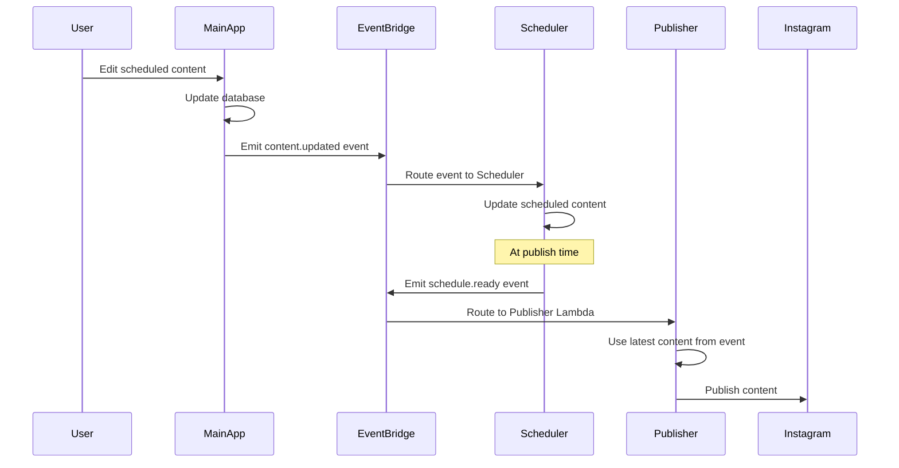

# Content Update Propagation in Microservices Architecture

## The Challenge

In a microservices architecture where:
- **Main App Service** owns content creation and editing
- **Scheduler Service** manages when content should be published
- **Publisher Service** handles the actual publishing

When a user updates content after scheduling, we need to propagate these changes to ensure the latest version is published.

## Solution: Event-Driven Content Synchronization

### Architecture Overview



## Implementation Details

### 1. Content Update Event (Main App → EventBridge)

```typescript
// In Main App: src/routes/content.ts
router.patch('/content/:contentId/edit', async (request, reply) => {
  const { contentId } = request.params;
  const updates = request.body;
  const userId = request.user.id;
  
  try {
    // 1. Update content in database
    const content = await prisma.content.update({
      where: { 
        id: contentId,
        brand: { userId } // Ensure user owns this content
      },
      data: {
        caption: updates.caption,
        hashtags: updates.hashtags,
        imageUrl: updates.imageUrl,
        updatedAt: new Date()
      },
      include: {
        brand: true
      }
    });
    
    // 2. Check if this content is scheduled
    if (content.status === 'scheduled' && content.scheduledAt) {
      // 3. Emit content updated event
      await eventBridge.putEvents({
        Entries: [{
          Source: 'postolio.content',
          DetailType: 'content.updated',
          Detail: JSON.stringify({
            contentId: content.id,
            brandId: content.brandId,
            userId,
            updates: {
              caption: content.caption,
              hashtags: content.hashtags,
              imageUrl: content.imageUrl,
              cdnImageUrl: content.cdnImageUrl
            },
            scheduledAt: content.scheduledAt,
            timestamp: new Date().toISOString(),
            version: content.version + 1 // Optimistic locking
          })
        }]
      });
      
      console.log('Content update event emitted:', contentId);
    }
    
    return reply.send({
      success: true,
      data: content
    });
    
  } catch (error) {
    console.error('Content update failed:', error);
    return reply.code(500).send({
      error: 'Failed to update content'
    });
  }
});
```

### 2. Scheduler Service Event Handler

```typescript
// In Scheduler Service: Handle content updates
export const contentUpdateHandler = async (event: EventBridgeEvent) => {
  const { contentId, brandId, updates, version } = event.detail;
  
  try {
    // 1. Find the schedule in DynamoDB
    const schedule = await dynamodb.query({
      TableName: 'schedules',
      IndexName: 'by-content',
      KeyConditionExpression: 'contentId = :contentId',
      ExpressionAttributeValues: {
        ':contentId': contentId
      }
    }).promise();
    
    if (!schedule.Items || schedule.Items.length === 0) {
      console.log('No schedule found for content:', contentId);
      return;
    }
    
    const scheduleItem = schedule.Items[0];
    
    // 2. Check version for race condition handling
    if (scheduleItem.contentVersion >= version) {
      console.log('Ignoring older update version:', version);
      return;
    }
    
    // 3. Update the scheduled content
    await dynamodb.update({
      TableName: 'schedules',
      Key: {
        scheduleId: scheduleItem.scheduleId,
        scheduledTime: scheduleItem.scheduledTime
      },
      UpdateExpression: `
        SET content = :content,
            contentVersion = :version,
            lastUpdated = :timestamp,
            updateHistory = list_append(if_not_exists(updateHistory, :empty_list), :update)
      `,
      ExpressionAttributeValues: {
        ':content': updates,
        ':version': version,
        ':timestamp': new Date().toISOString(),
        ':empty_list': [],
        ':update': [{
          timestamp: new Date().toISOString(),
          version,
          updatedFields: Object.keys(updates)
        }]
      },
      ConditionExpression: 'contentVersion < :version' // Prevent older updates
    }).promise();
    
    console.log('Schedule updated with new content:', scheduleId);
    
    // 4. Emit confirmation event (for audit/monitoring)
    await eventBridge.putEvents({
      Entries: [{
        Source: 'postolio.scheduler',
        DetailType: 'schedule.content.updated',
        Detail: JSON.stringify({
          scheduleId: scheduleItem.scheduleId,
          contentId,
          brandId,
          version,
          timestamp: new Date().toISOString()
        })
      }]
    });
    
  } catch (error) {
    console.error('Failed to update scheduled content:', error);
    
    // Emit error event for monitoring
    await eventBridge.putEvents({
      Entries: [{
        Source: 'postolio.scheduler',
        DetailType: 'schedule.update.failed',
        Detail: JSON.stringify({
          contentId,
          error: error.message,
          timestamp: new Date().toISOString()
        })
      }]
    });
  }
};
```

### 3. EventBridge Rules Configuration

```typescript
// CDK: EventBridge rules for content updates
const contentUpdateRule = new events.Rule(this, 'ContentUpdateRule', {
  eventBus: eventBus,
  eventPattern: {
    source: ['postolio.content'],
    detailType: ['content.updated']
  },
  targets: [
    new targets.LambdaFunction(schedulerUpdateHandler, {
      deadLetterQueue: dlq,
      maxEventAge: cdk.Duration.minutes(5),
      retryAttempts: 2
    })
  ]
});
```

### 4. Race Condition Handling

```typescript
// Version-based optimistic locking
interface ContentVersion {
  contentId: string;
  version: number;
  lastModified: string;
  hash: string; // SHA256 of content for integrity
}

class ContentVersionManager {
  // Generate content hash for integrity checking
  private generateHash(content: any): string {
    const crypto = require('crypto');
    const contentString = JSON.stringify({
      caption: content.caption,
      hashtags: content.hashtags,
      imageUrl: content.imageUrl
    });
    return crypto.createHash('sha256').update(contentString).digest('hex');
  }
  
  // Check if update should be applied
  async shouldApplyUpdate(
    scheduleId: string,
    newVersion: number,
    newHash: string
  ): Promise<boolean> {
    const current = await this.getCurrentVersion(scheduleId);
    
    // Version check
    if (current.version >= newVersion) {
      console.log('Rejecting older version:', newVersion);
      return false;
    }
    
    // Hash check (prevent duplicate updates)
    if (current.hash === newHash) {
      console.log('Content unchanged, skipping update');
      return false;
    }
    
    return true;
  }
  
  // Handle publishing-time race condition
  async getContentForPublishing(scheduleId: string): Promise<any> {
    // Lock the schedule to prevent updates during publishing
    const locked = await this.lockSchedule(scheduleId, 30); // 30 second lock
    
    if (!locked) {
      throw new Error('Could not acquire lock for publishing');
    }
    
    try {
      const schedule = await this.getSchedule(scheduleId);
      return schedule.content;
    } finally {
      await this.unlockSchedule(scheduleId);
    }
  }
}
```

### 5. Complete Update Flow with Audit Trail

```typescript
// Main App: Comprehensive update handler
class ContentUpdateService {
  async updateScheduledContent(
    contentId: string,
    updates: ContentUpdate,
    userId: string
  ): Promise<void> {
    const transaction = await prisma.$transaction(async (tx) => {
      // 1. Get current content with lock
      const current = await tx.content.findUnique({
        where: { id: contentId },
        include: { brand: true }
      });
      
      if (!current) throw new NotFoundError('Content not found');
      if (current.brand.userId !== userId) throw new UnauthorizedError();
      
      // 2. Update content
      const updated = await tx.content.update({
        where: { id: contentId },
        data: {
          ...updates,
          version: { increment: 1 },
          updatedAt: new Date()
        }
      });
      
      // 3. Create audit log
      await tx.auditLog.create({
        data: {
          action: 'content.updated',
          entityId: contentId,
          entityType: 'content',
          userId,
          changes: JSON.stringify(updates),
          timestamp: new Date()
        }
      });
      
      return updated;
    });
    
    // 4. Emit event if scheduled
    if (transaction.status === 'scheduled') {
      await this.emitContentUpdateEvent(transaction);
    }
  }
  
  private async emitContentUpdateEvent(content: Content): Promise<void> {
    // Include full content in event for scheduler
    const event = {
      Source: 'postolio.content',
      DetailType: 'content.updated',
      Detail: JSON.stringify({
        contentId: content.id,
        brandId: content.brandId,
        version: content.version,
        content: {
          caption: content.caption,
          hashtags: content.hashtags,
          imageUrl: content.imageUrl,
          cdnImageUrl: content.cdnImageUrl
        },
        scheduledAt: content.scheduledAt,
        timestamp: new Date().toISOString(),
        updateReason: content.updateReason || 'user_edit'
      })
    };
    
    await eventBridge.putEvents({ Entries: [event] });
  }
}
```

### 6. Handling Edge Cases

```typescript
// Edge Case Handlers
class EdgeCaseHandlers {
  // Case 1: Update arrives after content is published
  async handleLateUpdate(event: ContentUpdateEvent): Promise<void> {
    const content = await prisma.content.findUnique({
      where: { id: event.contentId }
    });
    
    if (content.status === 'published') {
      // Option A: Update the published post (if platform supports it)
      if (this.platformSupportsEditing(content.platform)) {
        await this.editPublishedPost(content);
      }
      
      // Option B: Log for manual intervention
      await this.alertContentTeam({
        message: 'Content updated after publishing',
        contentId: content.id,
        publishedAt: content.publishedAt,
        updatedAt: event.timestamp
      });
    }
  }
  
  // Case 2: Multiple rapid updates
  async handleRapidUpdates(events: ContentUpdateEvent[]): Promise<void> {
    // Debounce updates - only apply the latest
    const latestByContent = new Map<string, ContentUpdateEvent>();
    
    for (const event of events) {
      const existing = latestByContent.get(event.contentId);
      if (!existing || event.version > existing.version) {
        latestByContent.set(event.contentId, event);
      }
    }
    
    // Apply only the latest update for each content
    for (const event of latestByContent.values()) {
      await this.applyUpdate(event);
    }
  }
  
  // Case 3: Scheduler service is down
  async handleSchedulerOutage(event: ContentUpdateEvent): Promise<void> {
    // Store in DLQ with exponential backoff retry
    await sqs.sendMessage({
      QueueUrl: process.env.CONTENT_UPDATE_DLQ,
      MessageBody: JSON.stringify(event),
      MessageAttributes: {
        RetryCount: { DataType: 'Number', StringValue: '0' },
        OriginalTimestamp: { DataType: 'String', StringValue: event.timestamp }
      }
    }).promise();
  }
}
```

## Benefits of This Approach

### 1. **Data Consistency**
- Content updates propagate automatically
- Version control prevents race conditions
- Audit trail for compliance

### 2. **Loose Coupling**
- Services remain independent
- No shared database access
- Clear event contracts

### 3. **Resilience**
- Dead letter queues for failed updates
- Retry logic with exponential backoff
- Graceful degradation

### 4. **Scalability**
- Asynchronous processing
- No blocking operations
- Horizontal scaling of handlers

## Alternative Patterns Considered

### Pattern A: Pull Model (Rejected)
```
Publisher pulls latest content at publish time
❌ Requires shared database or API calls
❌ Increases latency at publish time
❌ Tight coupling between services
```

### Pattern B: Two-Phase Commit (Rejected)
```
Coordinate updates across services
❌ Complex to implement
❌ Reduces availability
❌ Not suitable for distributed systems
```

### Pattern C: Event Sourcing (Considered)
```
Store all changes as events
✅ Complete audit trail
✅ Can replay to any state
❌ More complex for this use case
❌ Requires event store infrastructure
```

## Monitoring & Observability

```typescript
// CloudWatch metrics for update propagation
const metrics = {
  'ContentUpdates.Emitted': 'Count of update events sent',
  'ContentUpdates.Processed': 'Successfully processed updates',
  'ContentUpdates.Failed': 'Failed update attempts',
  'ContentUpdates.Latency': 'Time from update to scheduler acknowledgment',
  'ContentUpdates.VersionConflicts': 'Rejected due to version mismatch'
};

// Sample dashboard query
{
  "MetricWidget": {
    "metrics": [
      ["Postolio", "ContentUpdates.Latency", {"stat": "Average"}],
      [".", "ContentUpdates.Failed", {"stat": "Sum"}],
      [".", "ContentUpdates.VersionConflicts", {"stat": "Sum"}]
    ],
    "period": 300,
    "stat": "Average",
    "region": "us-east-1",
    "title": "Content Update Propagation"
  }
}
```

## Migration Plan

### Phase 1: Event Infrastructure (Day 1-2)
1. Deploy EventBridge rules
2. Create DLQ for failed events
3. Add event emission to content update endpoint

### Phase 2: Scheduler Integration (Day 3-4)
1. Deploy update handler Lambda
2. Modify scheduler to store content
3. Add version tracking

### Phase 3: Monitoring (Day 5)
1. Create CloudWatch dashboard
2. Set up alerts for failures
3. Test with production-like load

## Conclusion

This event-driven approach ensures:
- **Latest content is always published**
- **No shared database between services**
- **Clear audit trail of all changes**
- **Resilient to service failures**
- **Follows industry best practices**

The pattern is used successfully by:
- **Hootsuite**: Events for content synchronization
- **Buffer**: Update notifications across services
- **Sprout Social**: Event-driven content pipeline