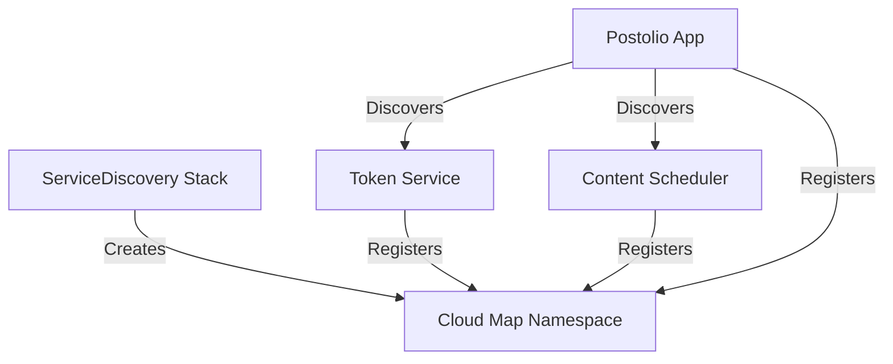

# Service Discovery Architecture

## Overview

Postolio uses AWS Cloud Map for service discovery, enabling microservices to discover and communicate with each other without hard-coded dependencies. This document describes the architecture and deployment patterns.

## Architecture Components

### 1. Shared Service Discovery Stack

The `ServiceDiscoveryStack` creates a single shared Cloud Map namespace that all services register with:

```typescript
// aws-infrastructure/lib/stacks/service-discovery-stack.ts
export class ServiceDiscoveryStack extends cdk.Stack {
  public readonly namespace: servicediscovery.INamespace;
  public readonly namespaceId: string;
  public readonly namespaceName: string;
}
```

**Namespace Format**: `postolio-{environment}.local`
- Example: `postolio-dev.local`

### 2. Service Registration

Each microservice registers itself with the shared namespace:

#### Token Service
- **Service Name**: `token-service`
- **Endpoint**: API Gateway URL
- **Type**: Lambda-based REST API

#### Content Scheduler
- **Service Name**: `content-scheduler`
- **Endpoint**: API Gateway URL
- **Type**: Lambda-based REST API

#### Postolio Main App
- **Service Name**: `postolio-app`
- **Endpoint**: ECS Service endpoint
- **Type**: ECS Fargate service

### 3. Service Discovery Flow



## Deployment Architecture

### Independent Deployment

Services can be deployed independently after the shared ServiceDiscovery stack:

1. **Deploy ServiceDiscovery Stack** (Required first)
   ```bash
   npx cdk deploy ServiceDiscovery-dev
   ```

2. **Deploy Services** (Any order)
   ```bash
   # These can be deployed in parallel or any order
   npx cdk deploy TokenService-dev
   npx cdk deploy ContentScheduler-dev
   npx cdk deploy Postolio-dev
   ```

### Deployment Scripts

The deployment scripts have been updated to reflect this architecture:

#### Main Deployment Script (`deploy-aws.sh`)
```bash
# 1. Deploy ServiceDiscovery first
npx cdk deploy ServiceDiscovery-$ENVIRONMENT

# 2. Deploy microservices (independent)
npx cdk deploy TokenService-$ENVIRONMENT
npx cdk deploy ContentScheduler-$ENVIRONMENT
npx cdk deploy Postolio-$ENVIRONMENT
```

#### Individual Service Deployment
```bash
# Deploy only ContentScheduler
./scripts/deploy-scheduler.sh dev
# This automatically checks for ServiceDiscovery stack
```

## Benefits of Decoupled Architecture

### 1. Independent Scaling
- Each service can scale independently based on load
- No cascading effects from one service to another

### 2. Independent Deployment
- Services can be updated without affecting others
- Faster deployment cycles
- Reduced risk of breaking changes

### 3. Resilience
- Service failures are isolated
- Circuit breakers prevent cascade failures
- Graceful degradation when services are unavailable

### 4. Development Flexibility
- Teams can work on services independently
- Different technology stacks possible per service
- Clear service boundaries and contracts

## Service Communication Patterns

### Runtime Discovery

Services discover each other at runtime using Cloud Map:

```typescript
// Example: Discovering Token Service
const tokenServiceEndpoint = await serviceDiscovery.discoverService('token-service');
```

### Circuit Breaker Pattern

All service-to-service communication uses circuit breakers:

```typescript
const circuitBreaker = new CircuitBreaker(apiCall, {
  timeout: 10000,
  errorThresholdPercentage: 50,
  resetTimeout: 30000,
});
```

### Fallback Strategies

When a service is unavailable:
- **Token Service**: Fall back to cached tokens
- **Content Scheduler**: Queue for retry
- **Analytics**: Continue with degraded functionality

## Migration from Tight Coupling

### Previous Architecture (Tight Coupling)
```typescript
// BEFORE: Direct stack references
const postolioStack = new PostolioStack(app, {
  contentSchedulerStack,  // Direct reference
  tokenServiceUrl: tokenServiceStack.apiUrl,  // Direct property access
});
postolioStack.addDependency(contentSchedulerStack);
postolioStack.addDependency(tokenServiceStack);
```

### New Architecture (Decoupled)
```typescript
// AFTER: Service discovery
const postolioStack = new PostolioStack(app, {
  serviceDiscoveryNamespaceId: serviceDiscoveryStack.namespaceId,
  // No direct service references
});
// No explicit dependencies between service stacks
```

## Monitoring and Observability

### Health Checks

Each service exposes health endpoints:
- `/health` - Basic health check
- `/health/ready` - Readiness check
- `/health/live` - Liveness check

### Service Metrics

Cloud Map tracks:
- Service registration/deregistration
- Instance health
- Discovery requests

### CloudWatch Integration

All services emit metrics to CloudWatch:
- Request count
- Error rate
- Latency
- Discovery failures

## Best Practices

### 1. Service Registration
- Always register services with descriptive names
- Include metadata (version, environment, type)
- Update registration on configuration changes

### 2. Service Discovery
- Cache discovery results with appropriate TTL
- Implement retry logic with exponential backoff
- Use circuit breakers for all external calls

### 3. Error Handling
- Log all discovery failures
- Implement graceful degradation
- Monitor circuit breaker states

### 4. Security
- Use IAM roles for service authentication
- Encrypt service-to-service communication
- Audit all service discovery requests

## Troubleshooting

### Common Issues

1. **Service Not Found**
   - Check service is registered in Cloud Map
   - Verify namespace is correct
   - Check IAM permissions for discovery

2. **Connection Timeouts**
   - Check security groups
   - Verify network connectivity
   - Check service health

3. **Stale Service Endpoints**
   - Check TTL settings
   - Force refresh discovery cache
   - Verify service registration updates

### Debug Commands

```bash
# List all services in namespace
aws servicediscovery list-services \
  --filters Name=NAMESPACE_ID,Values=<namespace-id>

# Get service details
aws servicediscovery get-service \
  --id <service-id>

# List service instances
aws servicediscovery list-instances \
  --service-id <service-id>
```

## Future Enhancements

### Planned Improvements
1. **Service Mesh Integration**: Add AWS App Mesh for advanced traffic management
2. **Multi-Region Discovery**: Extend to cross-region service discovery
3. **gRPC Support**: Add support for gRPC service communication
4. **Service Versioning**: Implement version-aware discovery

### Migration Path
1. Current: HTTP namespace with REST APIs
2. Next: Add DNS namespace for internal services
3. Future: Full service mesh with traffic policies

## Summary

The decoupled service discovery architecture provides:
- **Flexibility**: Services can evolve independently
- **Resilience**: Failures are isolated
- **Scalability**: Services scale based on their needs
- **Maintainability**: Clear service boundaries and contracts

This architecture positions Postolio for growth while maintaining system reliability and developer productivity.