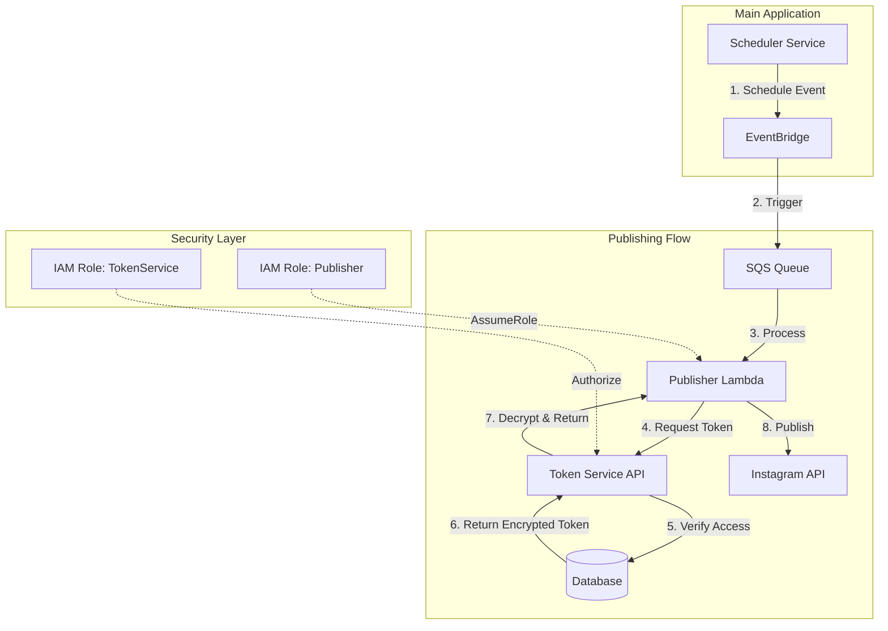

# Token Service Architecture for Microservices

## Problem Statement
OAuth tokens for social media platforms (Instagram, Facebook, LinkedIn) are:
- **Dynamic user data** that changes frequently (refresh tokens)
- **Encrypted sensitive data** requiring secure storage and transmission
- **Multi-tenant resources** requiring strict access control
- **Platform-specific** with different refresh patterns and expiration times

## Industry-Standard Solution: Dedicated Token Service

### Architecture Overview



## Implementation Pattern

### 1. Event Structure (Contains Reference, Not Token)

```typescript
interface PublishEvent {
  contentId: string;
  brandId: string;
  userId: string;  // For access control
  platform: 'instagram' | 'facebook' | 'linkedin';
  content: {
    caption: string;
    hashtags: string[];
    imageUrl: string;
  };
  scheduledTime: string;
  // NO TOKENS IN EVENT - just references
}
```

### 2. Token Service API (New Internal Service)

```typescript
// Token Service - Internal API with IAM authentication
class TokenService {
  // Fastify route with IAM verification
  async getToken(request: FastifyRequest) {
    const { brandId, platform, requesterId } = request.body;
    
    // 1. Verify IAM signature (automatic with AWS SDK)
    const identity = await this.verifyIAMIdentity(request);
    
    // 2. Verify the requester owns this brand
    const brand = await prisma.brand.findUnique({
      where: { id: brandId },
      include: { user: true }
    });
    
    if (brand.userId !== requesterId) {
      throw new UnauthorizedError('Access denied to brand tokens');
    }
    
    // 3. Get encrypted token from database
    const tokenField = `${platform}AccessToken`;
    const encryptedToken = brand[tokenField];
    
    if (!encryptedToken) {
      throw new NotFoundError(`No ${platform} token for brand`);
    }
    
    // 4. Check if token needs refresh
    const tokenData = await this.decryptToken(encryptedToken);
    if (this.isExpiringSoon(tokenData)) {
      tokenData = await this.refreshToken(platform, tokenData);
      await this.saveRefreshedToken(brandId, platform, tokenData);
    }
    
    // 5. Return token (will be encrypted in transit via HTTPS)
    return {
      accessToken: tokenData.accessToken,
      expiresAt: tokenData.expiresAt
    };
  }
  
  private async refreshToken(platform: string, tokenData: any) {
    switch(platform) {
      case 'instagram':
        // Instagram tokens are long-lived (60 days)
        return this.refreshInstagramToken(tokenData);
      case 'linkedin':
        // LinkedIn tokens expire in 60 days
        return this.refreshLinkedInToken(tokenData);
      default:
        throw new Error(`Unsupported platform: ${platform}`);
    }
  }
}
```

### 3. Publisher Lambda (Calls Token Service)

```typescript
// Publisher Lambda
export const handler = async (event: SQSEvent) => {
  for (const record of event.Records) {
    const publishEvent: PublishEvent = JSON.parse(record.body);
    
    try {
      // 1. Get token from Token Service (using IAM auth)
      const tokenResponse = await fetch(
        `${process.env.TOKEN_SERVICE_URL}/internal/tokens/get`,
        {
          method: 'POST',
          headers: {
            'Content-Type': 'application/json',
            // AWS SDK automatically adds IAM signature headers
          },
          body: JSON.stringify({
            brandId: publishEvent.brandId,
            platform: publishEvent.platform,
            requesterId: publishEvent.userId
          }),
          // Use AWS SDK's request signing
          aws: { sign: true }
        }
      );
      
      if (!tokenResponse.ok) {
        throw new Error(`Token service error: ${tokenResponse.statusText}`);
      }
      
      const { accessToken } = await tokenResponse.json();
      
      // 2. Publish to platform
      const result = await publishToInstagram({
        accessToken,
        content: publishEvent.content
      });
      
      // 3. Update content status via event
      await eventBridge.putEvents({
        Entries: [{
          Source: 'postolio.publisher',
          DetailType: 'content.published',
          Detail: JSON.stringify({
            contentId: publishEvent.contentId,
            platform: publishEvent.platform,
            publishedId: result.id,
            permalink: result.permalink,
            publishedAt: new Date().toISOString()
          })
        }]
      });
      
    } catch (error) {
      // Send to DLQ for retry
      console.error('Publishing failed:', error);
      throw error;
    }
  }
};
```

## Why This Pattern?

### 1. **Security**
- Tokens never leave the secure perimeter
- IAM provides service-to-service authentication
- Access control enforced at token retrieval

### 2. **Scalability**
- Token Service can cache decrypted tokens in memory
- Refresh logic centralized and optimized
- Publisher Lambda remains stateless

### 3. **Maintainability**
- Single source of truth for tokens
- Centralized refresh logic
- Easy to add new platforms

### 4. **Compliance**
- Audit trail of token access
- Encryption at rest and in transit
- GDPR-compliant data isolation

## Industry Examples

### Hootsuite
- Separate "Credentials Service" managing OAuth tokens
- Services request tokens via internal API with team/user context
- Tokens cached in Redis with TTL for performance

### Buffer
- "Account Service" owns social account connections
- Publishing workers request tokens at publish time
- Automatic refresh handled by Account Service

### Later
- Token Vault service with encryption
- Services authenticate via mutual TLS
- Token rotation automated with platform-specific logic

## Migration Path

### Phase 1: Token Service API (Week 1)
1. Create `/internal/tokens/get` endpoint
2. Implement IAM authentication middleware
3. Add token refresh logic
4. Deploy as ECS service in private subnet

### Phase 2: Update Publisher Lambda (Week 2)
1. Remove direct database access
2. Add Token Service client with IAM signing
3. Update error handling for token failures
4. Test with expired tokens

### Phase 3: Monitoring & Optimization (Week 3)
1. Add CloudWatch metrics for token refresh rate
2. Implement Redis caching for hot tokens
3. Add circuit breaker for Token Service calls
4. Set up alerts for refresh failures

## Cost Analysis

### Current (Direct Database Access)
- ❌ Lambda in VPC: +10-15% cold start latency
- ❌ RDS Proxy or direct connection: $15-50/month
- ❌ Complex networking: NAT Gateway costs

### Proposed (Token Service)
- ✅ Lambda outside VPC: Fast cold starts
- ✅ Token Service in ECS: ~$30/month (shared with main app)
- ✅ Simple networking: No NAT Gateway needed
- ✅ Redis cache: Reduces database load

## Security Considerations

### Token Encryption
```typescript
// Token storage in database (existing)
{
  instagramAccessToken: encrypted_blob,  // AES-256 encrypted
  tokenExpiresAt: timestamp,
  refreshToken: encrypted_blob,
  lastRefreshed: timestamp
}
```

### IAM Policy for Publisher Lambda
```json
{
  "Version": "2012-10-17",
  "Statement": [
    {
      "Effect": "Allow",
      "Action": [
        "execute-api:Invoke"
      ],
      "Resource": "arn:aws:execute-api:region:account:api-id/*/POST/internal/tokens/get"
    },
    {
      "Effect": "Allow",
      "Action": [
        "events:PutEvents"
      ],
      "Resource": "arn:aws:events:region:account:event-bus/default"
    }
  ]
}
```

### Audit Logging
```typescript
// Every token access is logged
{
  timestamp: '2024-01-10T10:30:00Z',
  action: 'token.accessed',
  brandId: 'brand123',
  platform: 'instagram',
  requesterId: 'user456',
  requesterService: 'publisher-lambda',
  sourceIp: '10.0.1.50',
  success: true
}
```

## Conclusion

This pattern:
1. **Respects your existing encrypted token storage**
2. **Follows microservices best practices** (no shared databases)
3. **Provides proper security** via IAM and access control
4. **Handles token refresh** automatically
5. **Scales efficiently** with caching and stateless Lambdas
6. **Matches industry standards** from Hootsuite, Buffer, and Later

The key insight: OAuth tokens are **user data** that needs a service, not **configuration** that goes in Secrets Manager.