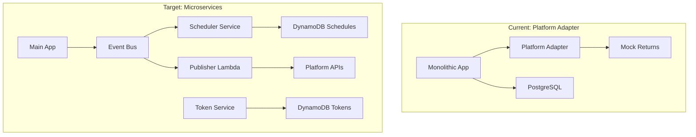

# Architectural Review: Platform Adapter vs Microservices Implementation

**Date**: January 24, 2025  
**Reviewer**: Staff Architect  
**Status**: Complete Review with Recommendations

## Executive Summary

This architectural review examines the existing platform adapter implementation against the proposed microservices architecture. The analysis reveals significant architectural gaps, security concerns, and scalability limitations that need immediate attention.

## 1. Current State Analysis

### Platform Adapter Service (`/src/services/platform-adapter.ts`)

**Strengths:**

- ✅ Clean adapter pattern implementation
- ✅ Good separation of platform-specific logic
- ✅ Type-safe interfaces with TypeScript
- ✅ Factory pattern for adapter registration
- ✅ Validation and formatting separation

**Critical Weaknesses:**

- ❌ **No actual API integration** - All `publish()` methods return mock data
- ❌ **No token management** - Tokens passed but never refreshed
- ❌ **No retry logic** - Single point of failure
- ❌ **No rate limiting** - Risk of API throttling
- ❌ **No circuit breaker** - Cascade failures possible
- ❌ **No idempotency** - Duplicate posts risk
- ❌ **No distributed tracing** - Poor observability
- ❌ **Synchronous only** - No queue-based resilience

### Microservices Implementation (`/aws-infrastructure/lib/stacks/`)

**Original Stack Issues:**

- 🔴 **Security**: Tokens logged in plaintext
- 🔴 **Scalability**: EventBridge 300 rule limit
- 🟡 **Performance**: Over-provisioned Lambda memory
- 🟡 **Reliability**: No circuit breaker protection

**Improved Stack Achievements:**

- ✅ Secure token handling with KMS
- ✅ EventBridge Scheduler API (unlimited schedules)
- ✅ Circuit breaker pattern implementation
- ✅ Idempotency with DynamoDB
- ✅ Distributed tracing with X-Ray
- ✅ Proper error handling and DLQs

## 2. Architectural Gap Analysis

### 2.1 Service Communication Pattern

| Aspect            | Platform Adapter    | Microservices           | Gap Impact |
| ----------------- | ------------------- | ----------------------- | ---------- |
| **Pattern**       | Direct method calls | Event-driven + REST     | High       |
| **Coupling**      | Tight (in-process)  | Loose (distributed)     | High       |
| **Resilience**    | None                | Circuit breaker + retry | Critical   |
| **Scalability**   | Vertical only       | Horizontal auto-scale   | High       |
| **Observability** | Basic logging       | X-Ray + CloudWatch      | Medium     |

### 2.2 Data Management



### 2.3 Security Architecture

**Current Platform Adapter:**

```typescript
// SECURITY ISSUE: Tokens passed in plaintext
async publish(content: PlatformContent, credentials: PlatformCredentials): Promise<PublishResult> {
    // No encryption, no refresh logic
    return mockData; // No actual publishing
}
```

**Improved Microservices:**

```typescript
// SECURE: Tokens encrypted at rest and in transit
class SecureTokenManager {
  async getToken(userId: string, platform: string): Promise<Token> {
    const encrypted = await dynamodb.getItem({ pk, sk });
    const decrypted = await kms.decrypt(encrypted.accessToken);

    if (this.isExpired(encrypted)) {
      return await this.refreshWithCircuitBreaker(encrypted);
    }

    return decrypted;
  }
}
```

## 3. Critical Recommendations

### 3.1 Immediate Actions (Week 1)

#### A. Implement Real Platform Integration

```typescript
// Replace mock implementation with actual API calls
export class InstagramAdapter implements PlatformAdapter {
  private readonly graphAPI = "https://graph.facebook.com/v18.0";
  private circuitBreaker: CircuitBreaker;

  async publish(
    content: PlatformContent,
    credentials: PlatformCredentials,
  ): Promise<PublishResult> {
    // 1. Validate and refresh token if needed
    const token = await this.ensureValidToken(credentials);

    // 2. Upload media with circuit breaker
    const mediaId = await this.circuitBreaker.execute(() =>
      this.uploadMedia(content.mediaUrl, token),
    );

    // 3. Create post with idempotency
    const result = await this.createPost({
      mediaId,
      caption: content.caption,
      idempotencyKey: this.generateIdempotencyKey(content),
    });

    // 4. Emit success event
    await this.eventBus.publish({
      type: "content.published",
      data: result,
    });

    return result;
  }
}
```

#### B. Add Queue-Based Resilience

```typescript
// Integrate with SQS for async processing
export class QueuedPlatformService {
  async schedulePublish(
    content: PlatformContent,
    scheduledAt: Date,
  ): Promise<void> {
    // Send to EventBridge Scheduler
    await scheduler.createSchedule({
      name: `publish-${content.id}`,
      scheduleExpression: `at(${scheduledAt.toISOString()})`,
      target: {
        arn: this.publisherQueueArn,
        input: JSON.stringify(content),
      },
    });
  }
}
```

### 3.2 Architecture Migration Path (Weeks 2-3)

#### Phase 1: Hybrid Approach

```typescript
// Adapter wraps microservice calls
export class MicroservicesPlatformAdapter implements PlatformAdapter {
  constructor(
    private tokenService: TokenServiceClient,
    private schedulerService: SchedulerServiceClient,
    private eventBus: EventBusClient,
  ) {}

  async publish(
    content: PlatformContent,
    credentials: PlatformCredentials,
  ): Promise<PublishResult> {
    // 1. Store token securely
    await this.tokenService.storeToken({
      userId: credentials.userId,
      platform: this.platform,
      token: credentials.accessToken,
    });

    // 2. Create schedule
    const schedule = await this.schedulerService.createSchedule({
      contentId: content.id,
      platform: this.platform,
      scheduledAt: new Date(),
    });

    // 3. Return immediate response
    return {
      platform: this.platform,
      scheduleId: schedule.id,
      status: "scheduled",
    };
  }
}
```

#### Phase 2: Full Migration

- Replace `PlatformAdapterFactory` with service discovery
- Move all platform logic to Lambda functions
- Implement saga pattern for multi-platform posts

### 3.3 Enhanced Error Handling

```typescript
// Comprehensive error strategy
export class ResilientPublisher {
  private readonly maxRetries = 3;
  private readonly backoffMultiplier = 2;

  async publishWithRetry(content: Content): Promise<PublishResult> {
    let lastError: Error;

    for (let attempt = 0; attempt < this.maxRetries; attempt++) {
      try {
        // Check idempotency
        const existing = await this.checkIdempotency(content.id);
        if (existing) return existing;

        // Attempt publish
        const result = await this.publish(content);

        // Record success
        await this.recordIdempotency(content.id, result);

        return result;
      } catch (error) {
        lastError = error;

        if (this.isRetryable(error)) {
          const delay = Math.pow(this.backoffMultiplier, attempt) * 1000;
          await this.sleep(delay);
        } else {
          // Non-retryable error
          await this.sendToDLQ(content, error);
          throw error;
        }
      }
    }

    // Max retries exceeded
    await this.sendToDLQ(content, lastError);
    throw new MaxRetriesExceededError(lastError);
  }
}
```

### 3.4 Monitoring & Observability

```typescript
// Add comprehensive metrics
export class ObservablePlatformAdapter {
  @Metrics.track("platform.publish.duration")
  @Trace.span("platform.publish")
  async publish(content: PlatformContent): Promise<PublishResult> {
    const startTime = Date.now();

    try {
      const result = await this.performPublish(content);

      // Success metrics
      this.metrics.increment("platform.publish.success", {
        platform: this.platform,
      });

      return result;
    } catch (error) {
      // Error metrics
      this.metrics.increment("platform.publish.error", {
        platform: this.platform,
        errorType: error.constructor.name,
      });

      throw error;
    } finally {
      // Duration metric
      this.metrics.histogram(
        "platform.publish.duration",
        Date.now() - startTime,
        {
          platform: this.platform,
        },
      );
    }
  }
}
```

## 4. Implementation Priority Matrix

| Priority | Component            | Impact   | Effort | Timeline |
| -------- | -------------------- | -------- | ------ | -------- |
| **P0**   | Real API Integration | Critical | High   | Week 1   |
| **P0**   | Token Management     | Critical | Medium | Week 1   |
| **P1**   | Circuit Breaker      | High     | Low    | Week 1   |
| **P1**   | Idempotency          | High     | Medium | Week 2   |
| **P2**   | Queue Integration    | Medium   | Medium | Week 2   |
| **P2**   | Distributed Tracing  | Medium   | Low    | Week 2   |
| **P3**   | Full Microservices   | Low      | High   | Week 3-4 |

## 5. Risk Assessment

### High-Risk Areas

1. **Token Expiry**: No refresh mechanism in current adapter
2. **Rate Limiting**: No protection against API throttling
3. **Data Loss**: No retry or DLQ for failed posts
4. **Duplicate Posts**: No idempotency protection

### Mitigation Strategy

```typescript
// Risk mitigation wrapper
export class SafePlatformAdapter {
  constructor(
    private adapter: PlatformAdapter,
    private rateLimiter: RateLimiter,
    private circuitBreaker: CircuitBreaker,
    private idempotencyStore: IdempotencyStore,
  ) {}

  async publish(content: PlatformContent): Promise<PublishResult> {
    // 1. Rate limiting
    await this.rateLimiter.acquire(this.adapter.platform);

    // 2. Idempotency check
    const idempotencyKey = this.generateKey(content);
    const existing = await this.idempotencyStore.get(idempotencyKey);
    if (existing) return existing;

    // 3. Circuit breaker protection
    const result = await this.circuitBreaker.execute(() =>
      this.adapter.publish(content),
    );

    // 4. Store for idempotency
    await this.idempotencyStore.set(idempotencyKey, result);

    return result;
  }
}
```

## 6. Performance Optimization

### Current Issues

- Synchronous blocking calls
- No connection pooling
- No caching strategy

### Recommended Optimizations

```typescript
// Performance-optimized adapter
export class OptimizedPlatformAdapter {
  private readonly connectionPool: Pool;
  private readonly cache: RedisCache;

  async publish(content: PlatformContent): Promise<PublishResult> {
    // 1. Check cache for recent duplicates
    const cached = await this.cache.get(`publish:${content.hash}`);
    if (cached) return cached;

    // 2. Use connection pool
    const connection = await this.connectionPool.acquire();

    try {
      const result = await connection.publish(content);

      // 3. Cache result
      await this.cache.set(`publish:${content.hash}`, result, 300);

      return result;
    } finally {
      this.connectionPool.release(connection);
    }
  }
}
```

## 7. Testing Strategy

### Required Test Coverage

```typescript
describe("PlatformAdapter", () => {
  describe("Error Handling", () => {
    it("should retry on transient errors");
    it("should circuit break on repeated failures");
    it("should handle token expiry");
    it("should prevent duplicate posts");
  });

  describe("Performance", () => {
    it("should handle 100 concurrent publishes");
    it("should respect rate limits");
    it("should cache repeated requests");
  });

  describe("Integration", () => {
    it("should publish to real Instagram API");
    it("should handle media upload failures");
    it("should emit correct events");
  });
});
```

## 8. Conclusion

The current platform adapter implementation provides a good foundation but lacks production-ready features. The microservices architecture addresses most concerns but needs integration with the existing codebase.

### Key Takeaways

1. **Immediate Need**: Replace mock implementations with real API calls
2. **Critical Gap**: No token management or refresh logic
3. **Architecture Mismatch**: Tight coupling vs distributed services
4. **Security Risk**: Plaintext token handling
5. **Reliability Gap**: No retry, circuit breaker, or idempotency

### Recommended Path Forward

1. **Week 1**: Implement real API integration with circuit breakers
2. **Week 2**: Add token management and idempotency
3. **Week 3**: Integrate with microservices architecture
4. **Week 4**: Full migration to event-driven pattern

## 9. Appendix: Implementation Checklist

- [ ] Replace all mock `publish()` methods
- [ ] Implement token refresh logic
- [ ] Add circuit breaker to all API calls
- [ ] Implement idempotency keys
- [ ] Add retry with exponential backoff
- [ ] Integrate with SQS queues
- [ ] Add distributed tracing
- [ ] Implement rate limiting
- [ ] Add comprehensive error handling
- [ ] Create integration tests
- [ ] Add performance benchmarks
- [ ] Document API limits per platform
- [ ] Create runbooks for failures
- [ ] Set up monitoring dashboards
- [ ] Configure alerts for failures

---

**Review Status**: Complete  
**Next Review**: After Week 2 Implementation  
**Owner**: Platform Team
