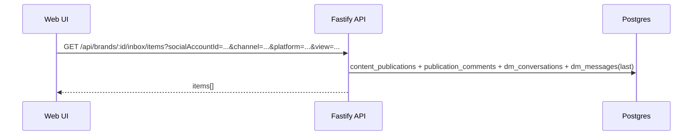
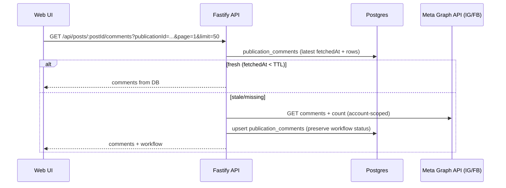
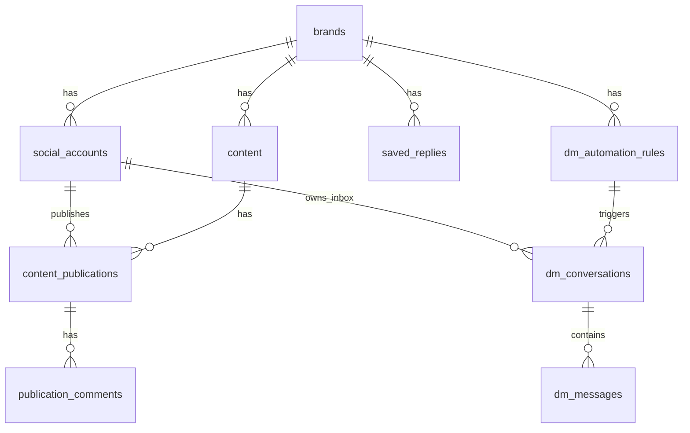

# Inbox — Current State (E2E)

**Date**: 2025-12-27  
**Status**: Inbox v2 implemented (unified UI + DB-first reads)  
**Scope**: Web Inbox UI + API routes + DB schema + Instagram webhook + Facebook comments proof

## 1) What “Inbox” is today

Inbox is now a unified experience backed by Postgres for fast reads:

1. **Unified Inbox** (`/inbox`): account picker + filters + combined list of comment threads and DM conversations.
2. **Saved Replies** (`/inbox/saved-replies`): CRUD for reusable reply templates (single canonical API).
3. **DM Automation** (`/dm-automation`): rules + analytics (separate from Inbox triage).

## 2) Frontend entry points

- Routes: `packages/apps/web/src/App.tsx`
  - `/inbox` → `packages/apps/web/src/pages/Inbox.tsx` (unified)
  - `/inbox/saved-replies` → `packages/apps/web/src/pages/SavedReplies.tsx`

### 2.1 Unified Inbox UI flow (high-level)

`packages/apps/web/src/pages/Inbox.tsx`:

- Fetches connected social accounts via `brandApi.getConnectedAccounts(brandId)` for the account picker.
- Fetches combined items via `brandApi.getInboxItems(brandId, { socialAccountIds, channel, platform, view })`.
- Selecting a **comment thread**:
  - `contentApi.getPostComments(postId, page=1, limit=50, { publicationId })`
  - Actions: reply / like / workflow / mark-all-read (all include `publicationId`)
- Selecting a **DM conversation**:
  - `dmAutomation.getConversationMessages(brandId, conversationId)`
  - `dmAutomation.sendMessage(brandId, conversationId, messageText)`

Server-side filters supported by the unified API:

- `socialAccountId[]` (multi-account isolation)
- `channel` (`comments|dms`)
- `platform` (`instagram|facebook|...`)
- `view` (`to_review|all`)

### 2.2 Saved Replies UI flow (high-level)

Saved replies are consistently fetched/managed via:

- `GET /api/brands/:brandId/saved-replies`
- `POST /api/brands/:brandId/saved-replies`
- `PUT /api/brands/:brandId/saved-replies/:replyId`
- `DELETE /api/brands/:brandId/saved-replies/:replyId`

Frontend callers use `savedReplies.*` only.

## 3) End-to-end flow diagrams

### 3.1 Unified Inbox items (DB-first)

### 3.2 Comments list (DB-first + read-through)

## 4) Backend routes and services involved

### 4.1 Unified Inbox items

- `GET /api/brands/:id/inbox/items` (supports `socialAccountId[]`, `channel`, `platform`, `view`, `limit`)  
  Implemented in: `packages/apps/api/src/routes/brands.ts`

Behavior:

- DB-first (no platform API calls on the list path).
- Returns a combined `items[]` list:
  - `comment_thread` (publication-centric, platform-aware)
  - `dm_conversation` (conversation-centric, platform-aware)
- Server-side filters:
  - `socialAccountId[]` to isolate multi-account data
  - `channel` and `platform` for unified Inbox UX

### 4.2 Comments: list + actions

- `GET /api/posts/:postId/comments?page=&limit=&publicationId=` (supports `refresh=true` to force a live Graph refresh)  
  Implemented in: `packages/apps/api/src/routes/post-detail.ts`

Behavior:

- DB-first (freshness TTL via `publication_comments.fetchedAt`).
- On stale/missing:
  - Fetches from platform Graph (Instagram/Facebook) using socialAccount-scoped credentials
  - Upserts into `publication_comments`
  - Preserves workflow status

Actions (all accept `publicationId`):

- Reply: `POST /api/posts/:postId/comments/:commentId/reply?publicationId=...`
- Like: `POST /api/posts/:postId/comments/:commentId/like?publicationId=...`
- Workflow: `POST /api/posts/:postId/comments/:commentId/workflow?publicationId=...`
- Mark all read: `POST /api/posts/:postId/comments/mark-all-read?publicationId=...`
  - Marks only `status='open'` → `resolved`
  - Creates `resolved` placeholders for IDs not yet persisted

### 4.3 Comments ingestion (manual + background)

- `POST /api/brands/:id/inbox/comments/ingest` (throttled)
- Service: `packages/apps/api/src/services/inbox-comments-ingestor.ts`

Behavior:

- Enqueues a Bull background job (`JobType.INBOX_COMMENTS_INGEST`) and returns `jobId` (no long-running work in the request handler).
- Iterates recent `ContentPublication` rows for the brand (currently Instagram + Facebook).
- Fetches comments using publication.socialAccountId-scoped credentials.
- Upserts into `publication_comments` with `fetchedAt` (preserves workflow status).
- Optional safety net: recurring backfill job (`JobType.INBOX_COMMENTS_BACKFILL`) can be enabled via `ENABLE_INBOX_COMMENTS_BACKFILL=true`.

### 4.4 DMs: account-scoped conversations + inbound persistence

Routes used by Inbox DM detail/actions:

- `GET /api/brands/:brandId/dm-automation/conversations/:conversationId/messages`
- `POST /api/brands/:brandId/dm-automation/conversations/:conversationId/messages`
- `PATCH /api/brands/:brandId/dm-automation/conversations/:conversationId` (state changes: archive/spam)

Key behavior:

- `dm_conversations` are unique by `(brandId, socialAccountId, platform, participantExternalUserId)` to support:
  - multiple platforms
  - multiple accounts per platform
- Inbound DMs are persisted from the Instagram webhook and broadcast via WebSockets.
- Unified Inbox list avoids N+1 queries for last message.

### 4.5 Instagram webhook (comments + messages)

- `POST /webhooks/instagram`  
  Implemented in: `packages/apps/api/src/routes/instagram-webhook.ts`

Behavior:

- Uses raw-body signature verification (`x-hub-signature-256`).
- Comments:
  - Maps `media.id` → `content_publications.externalPostId` → `(brandId, socialAccountId)`
  - Upserts `publication_comments` (`status='open'`)
  - Triggers DM automation with `socialAccountId`
- Messages:
  - Maps `recipient.id` → `social_accounts.externalAccountId/externalPageId` → `(brandId, socialAccountId)`
  - Upserts `dm_conversations`
  - Inserts inbound `dm_messages` (idempotent via unique index + externalMessageId lookup)
  - Broadcasts `dm_message` via WebSocket

## 5) Persistence: what is stored vs fetched live

### 5.1 Stored in Postgres

- Comments:
  - `publication_comments` stores text/username/likeCount and workflow status
  - `fetchedAt` marks freshness for DB-first reads
- DMs:
  - `dm_conversations` + `dm_messages` store outbound and inbound messages
- Saved replies:
  - `saved_replies`

### 5.2 Fetched live from platform Graph APIs

- Comments list fetch on stale/missing data (read-through cache).
- Reply/like actions.
- DM send actions (Instagram only for now).

## 6) Multi-account + multi-platform coverage

- Multi-account:
  - Inbox comments + DMs are scoped by `socialAccountId` (no “primary account leakage”).
  - Unified Inbox UI supports account picker + server-side filtering.
- Multi-platform:
  - Comments: Instagram + Facebook proof implemented on the same comment storage model.
  - DMs: schema is platform-agnostic, but send/webhooks are Instagram-only for now.

## 7) DB schema (Inbox-relevant subset)

Source of truth: `packages/libs/database/prisma/schema.prisma`

Key fields:

- `publication_comments`: `@@unique([publicationId, externalCommentId])`, `@@index([publicationId, status])`
- `dm_conversations`: `platform` required, `@@unique([brandId, socialAccountId, platform, participantExternalUserId])`
- `dm_messages`: `@@unique([conversationId, externalMessageId])` (idempotency)

## 8) Remaining gaps / follow-ups

- Comments pagination is not fully cursor-based end-to-end (deep paging requires a sync job to backfill).
- Long-term: move toward a platform-agnostic `InboxThread`/`InboxEvent` model and route surface.
