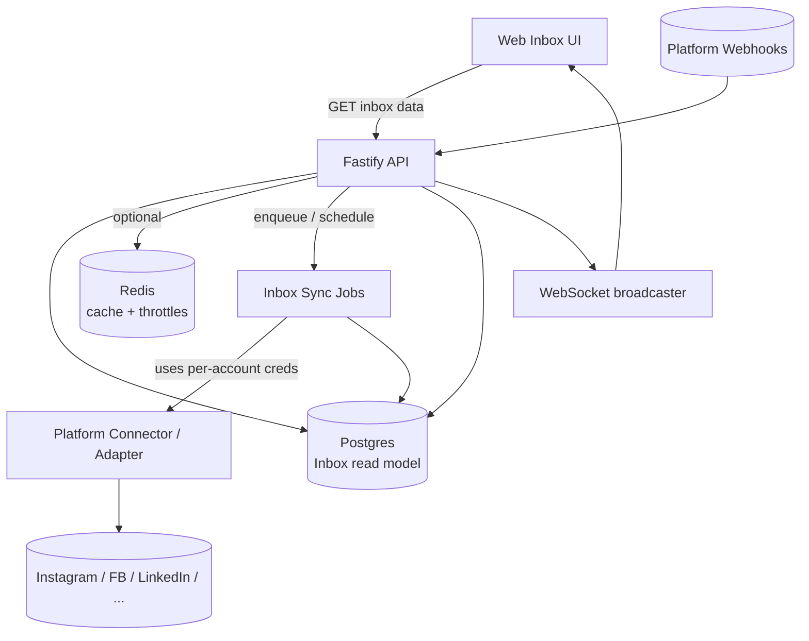
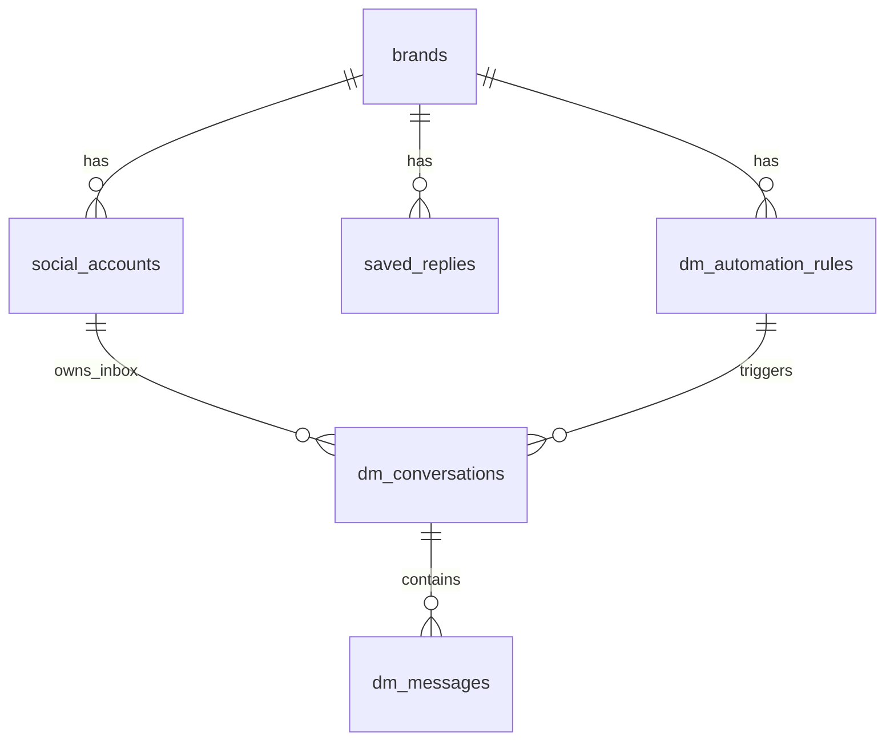

# Inbox — Proposed Improvements (Plan + Target Architecture)

**Date**: 2025-12-27  
**Status**: Living doc (proposal + implemented progress)  
**Related**: `docs/inbox/current-state.md`

## 1) Goals

1. **Stop doing live platform reads on the hot UI path** (except explicit “Refresh” actions).
2. **Persist Inbox data** (comments + DMs) so revisiting Inbox is cheap and fast.
3. **Support multiple platforms and multiple accounts** as first-class filters.
4. **Make the Inbox domain model cohesive** (one mental model, one API surface).
5. **Be resilient**: rate limits, retries, idempotency, and graceful degradation.

## 1.1 Greenfield constraint (important)

We currently have **no customers** and can tolerate **breaking changes**, including:

- Dropping/resetting production DB data if needed.
- Renaming/removing tables and endpoints without backwards-compat shims.
- Reworking the Inbox data model to be platform-agnostic and account-scoped.

Recommendation: treat this as an **Inbox v2** design problem (fix architecture first), not a patch series.

## 1.2 What’s already implemented (Inbox v2 foundations)

Implemented in this repo as part of the Inbox v2 foundations work:

- Unified Inbox UI at `/inbox` with account picker + filters and combined items list.
- Unified Inbox API: `GET /api/brands/:id/inbox/items` (comments + DMs).
- Saved replies API unified (single canonical `/api/brands/:brandId/saved-replies`).
- Comments inbox overview is DB-first and returns publication-centric items (`publicationId`).
- Comments list/actions are DB-first with read-through persistence + `publicationId` disambiguation (now Instagram + Facebook).
- Platform credentials are scoped by `socialAccountId` (no “primary account leakage” for Inbox).
- DM schema is platform-agnostic and account-scoped (`platform`, `participantExternalUserId`, `participantUsername`); inbound IG DMs are persisted from webhooks and broadcast over WebSockets.
- Destructive migration adds `DMConversation.socialAccountId` and indexes `publication_comments (publicationId, status)`.
- “Second platform” proof: Facebook comment threads flow through the same Inbox storage + UI.

Pointers:

- Docs: `docs/inbox/current-state.md`
- API: `packages/apps/api/src/routes/brands.ts`, `packages/apps/api/src/routes/post-detail.ts`
- Web: `packages/apps/web/src/pages/Inbox.tsx`
- Webhook: `packages/apps/api/src/routes/instagram-webhook.ts`
- Migrations:
  - `packages/libs/database/prisma/migrations/20251227120000_inbox_dm_conversations_account_scope/migration.sql`
  - `packages/libs/database/prisma/migrations/20251227123000_inbox_webhook_lookup_indexes/migration.sql`
  - `packages/libs/database/prisma/migrations/20251227124500_inbox_dm_message_idempotency/migration.sql`
  - `packages/libs/database/prisma/migrations/20251227150000_inbox_dm_platform_agnostic/migration.sql`

## 2) Remaining problems / open questions

- Comments pagination/backfill needs a cursor-based sync strategy for deep history.
- Webhook completeness: periodic comments backfill job exists (feature-flagged) to heal missed webhook deliveries; still needs tuning + alerting.
- DB-enforced idempotency for inbound DMs is implemented (unique index on `(conversationId, externalMessageId)`).
- Facebook comments currently rely on DB-seeded/read-through data; a background sync job + webhook normalization (if desired) is still pending.
- DMs are platform-agnostic in storage, but send/webhooks are Instagram-only for now.

## 3) Target architecture (high level)

### 3.1 Principle: read from DB, sync in background

**UI read path**:

- Read from Postgres “Inbox read model” (and optionally Redis cache).
- Trigger background sync when data is stale (non-blocking).
- Provide explicit “Refresh” button for immediate sync attempts.

**Write/ingest path**:

- Prefer webhooks for real-time updates (comments + DMs).
- Use periodic polling/backfill for completeness and to heal webhook gaps.

### 3.2 Unify credentials: always key by `socialAccountId`

**Rule**: any platform API call must be scoped to the specific `SocialAccount` it belongs to.

Proposed API/service shape:

- Add `PublisherCredentialsService.getCredentialsForSocialAccount(socialAccountId)` (and equivalents per platform).
- Keep `getCredentialsForBrand(brandId)` only as a convenience wrapper that resolves primary/default accounts.

This removes “primary account leakage” in:

- comments read/reply/like
- comment ingestion
- DM send + inbound processing
- rate limiting (should be per account, not per brand)

## 4) Proposed data model changes

### 4.1 Comments: reuse `publication_comments` as the local source of truth

Keep `PublicationComment` as the canonical “Inbox comment item” storage:

- Upsert comment content whenever we fetch it (poll, read-through cache, webhook).
- Preserve workflow status (`open/resolved/archived`) on updates.
- Update `fetchedAt` every time the row is refreshed.

Schema additions (optional but recommended):

- Index by `(publicationId, status)` for efficient unread queries.
- Consider `externalParentCommentId` usage for nested replies if/when supported.

### 4.2 DMs: make conversations account-scoped and persist inbound

Current `DMConversation` is `(brandId, instagramUserId)` only. Proposed:

- Add `socialAccountId` (required) to `DMConversation`
- Add `platform` (required, enum) to `DMConversation` and `DMMessage`
- Replace IG-specific column names over time (or add generic columns and migrate gradually)

DM automation rules:

- Add optional `socialAccountId` on `DMAutomationRule` to scope a rule to a specific connected account.
- Default behavior if `socialAccountId` is null: apply to all accounts for the brand.

Suggested new uniqueness:

- `@@unique([brandId, socialAccountId, externalUserId])` (or external thread id if available)

Persist inbound messages:

- On webhook “messages”, upsert conversation + insert `DMMessage(direction='inbound')`.
- Broadcast via WebSocket so Inbox updates instantly.

### 4.3 Saved Replies: one route + one response shape

Pick one canonical API:

- Prefer `/api/brands/:brandId/saved-replies` (already used by Saved Replies page)
- Add an alias route for backward compatibility if needed, but ensure the response shape is identical.

Also ensure React Query keys do not collide across differing shapes.

### 4.4 Proposed schema shape (Inbox-relevant)

## 5) API surface proposal (incremental, low-risk)

Because we can do breaking changes, there are two viable approaches:

- **Option A (incremental)**: keep existing endpoints and progressively reduce live Graph reads.
- **Option B (recommended, Inbox v2)**: introduce a cohesive, platform-agnostic Inbox API + storage model, then refactor UI and automation to use it.

The rest of this document assumes **Option B** unless explicitly stated otherwise.

### 5.1 Keep existing endpoints, make them cheaper + correct

Comments:

- Prefer `GET /api/brands/:id/inbox/items?channel=comments&view=...` (canonical list endpoint).
  - Compute `newCount` from `status=open` (exclude `archived`).
  - Use DB groupBy to avoid N+1 counts.
  - Avoid per-publication Graph calls in the overview path.
  - Option: if freshness is required, trigger background ingestion and return cached counts.

- `GET /api/posts/:postId/comments`
  - Change to “read-through cache”:
    - If `publication_comments.fetchedAt` is fresh (e.g., < 60s), return DB rows.
    - Otherwise fetch from platform, upsert rows, then return.
  - Fix pagination behavior (either implement cursoring or remove `page` param).
  - Use credentials for the publication’s `socialAccountId`.

DMs:

- Keep `/api/brands/:brandId/dm-automation/*` as-is for Phase 1, but:
  - Persist inbound messages from webhooks.
  - Add `socialAccountId` so multiple IG accounts don’t collide.
  - Update `dm-rate-limiter` to key by socialAccountId.

Saved replies:

- Standardize to one set of routes and one response.

### 5.2 Add one explicit sync endpoint per inbox channel

- `POST /api/brands/:brandId/inbox/comments/sync` (or reuse `/ingest`)
- `POST /api/brands/:brandId/inbox/dms/sync`

Requirements:

- Throttle per `(brandId, socialAccountId, channel)` in Redis.
- Run async; return `{ enqueued: true, nextAllowed }`.

## 6) Webhook fixes (Instagram)

### 6.1 Comments webhook: resolve brand via `ContentPublication.externalPostId`

Instead of mapping a comment event using “account lookup”, resolve it via the post/media id:

1. `media.id` (IG media id) → `content_publications.externalPostId`
2. That publication has `socialAccountId` → `social_accounts.brandId`
3. Upsert into `publication_comments` using `(publicationId, externalCommentId)`

Then:

- broadcast `comment_created` (new WS event type)
- update comment counts in DB (or compute on query)

### 6.2 Messages webhook: persist inbound + scope to account

1. Use `recipient.id` to locate `social_accounts` (page/account id).
2. Upsert `DMConversation(brandId, socialAccountId, externalUserId=sender.id)`.
3. Insert inbound `DMMessage(externalMessageId=mid, direction='inbound', messageText=...)`.
4. Broadcast `dm_message(direction='inbound')`.

## 7) Multi-platform strategy

Short term:

- Keep Inbox UI Instagram-only, but refactor API and storage to be platform-ready:
  - all tables carry `platform`
  - all services require `socialAccountId`

Medium term:

- Use `packages/libs/connectors` as the platform abstraction for Inbox capabilities:
  - Expand connector interface to include DM threads/messages where supported.
  - Implement per-platform capabilities (`comments`, `directMessages`).
  - API routes become “platform-agnostic orchestration + validation”.

Long term (unified Inbox):

- Introduce a generic `InboxThread` + `InboxEvent` model spanning:
  - comments, DMs, mentions, reviews, etc.
- UI becomes one Inbox with filters:
  - account selector (multi-select)
  - platform filter
  - channel filter (comments/dms/...)
  - state filter (open/resolved/archived)

## 8) Implementation roadmap (phased)

**Progress (as of 2025-12-27)**:

- Phase 1: done (schema + saved replies + platform-agnostic DMs).
- Phase 2: done (webhooks + inbound persistence + account-scoped creds).
- Phase 3: done (DB-first reads + explicit refresh).
- Phase 4: done (unified Inbox UX with account/platform/channel filters).
- Phase 5: done (Facebook comments proof).
- Phase 6: in progress (tests/observability).
- Phase 7: done (remove legacy Inbox pages/endpoints).

### Phase 0 — design freeze (1–2 days)

- Decide Inbox v2 domain model:
  - thread/message schema, workflow states, and indexing strategy
  - required filters: `platform`, `socialAccountId[]`, `channel`, `status`
- Decide platform abstraction boundary:
  - extend `packages/libs/connectors` for Inbox reads (comments + DMs) and webhook normalization
- Decide data retention defaults (PII): DM/message storage + deletion policy.

### Phase 1 — destructive schema + API cleanup (2–4 days)

- [x] Implement schema changes with **destructive migration** (safe given no customers):
  - [x] Add `socialAccountId` to DM tables (`DMConversation`)
  - [x] Add `platform` to DM tables (future-proofing)
  - [x] Ensure inbox tables are indexed for list queries (comment status index)
- [x] Delete/merge duplicate saved replies APIs:
  - [x] Keep `/api/brands/:brandId/saved-replies` only
  - [x] Update UI callers and query keys to match one response shape

### Phase 2 — correct ingestion (webhooks first) (3–6 days)

- [x] Fix Instagram comment webhook mapping (media id → `content_publications.externalPostId` → brand/socialAccount).
- [x] Persist inbound DMs from webhook into DB and broadcast over WebSockets.
- [x] Enforce inbound DM idempotency in DB (unique `(conversationId, externalMessageId)`).
- [x] Ensure all platform calls are scoped by `socialAccountId` credentials (no “primary account leakage”).

### Phase 3 — read model + performance (3–7 days)

- Comments:
  - [x] Switch UI reads to DB-first with freshness (`fetchedAt`)
  - [x] Add explicit refresh actions (UI)
  - [x] Add backfill/sync job to heal missing webhook deliveries (optional; enable via `ENABLE_INBOX_COMMENTS_BACKFILL=true`)
- DMs:
  - [x] Remove N+1 queries for last message on conversation list
  - [x] Align DM rate limiting to **per social account**

### Phase 4 — multi-account UI + filters (3–7 days)

- [x] Add account selector (multi-select) for Comments (Instagram accounts)
- [x] Add account selector (multi-select) for DMs (Instagram accounts)
- [x] Add platform filter (for multi-platform readiness)
- [x] Add channel filter (comments/dms/...)
- [x] Confirm endpoints accept `socialAccountId[]` (server-side filtering) and return aggregated counts
- [x] Add server-side filtering via `socialAccountId[]` (comments inbox + DM conversations)

### Phase 5 — “new platform” proof (timebox 3–5 days)

- [x] Add one additional platform capability end-to-end (even if partial) to validate extensibility:
  - Facebook comments (same Meta ecosystem)
- [x] Deliverables:
  - Inbox list + detail working for the new platform (DB-first + optional refresh)

### Phase 6 — correctness + DX hardening (ongoing)

- Add integration tests for:
  - webhook ingestion → DB → websocket update
  - multi-account scoping and isolation
- Add observability:
  - per-platform sync lag metrics
  - queue depth, error rates, retry counts

### Phase 7 — purge legacy Inbox pages (done)

- [x] Delete legacy Inbox pages (`/inbox/comments`, `/inbox/dms`) and related UI components.
- [x] Remove legacy Inbox comments overview API (`GET /api/brands/:id/inbox/comments`) and client calls.
- [x] Update navigation and dashboard links to point to `/inbox` only.

## 9) Risks / open questions

- Meta webhook payload details need to be verified against current app subscriptions (fields, ids, guarantees).
- Data retention + privacy: storing comments/DMs expands PII footprint; align with deletion flows and retention policy.
- Pagination and completeness: Graph API limitations may require cursor-based sync and incremental storage.
- Cross-posting: one Postolio “post” may map to multiple publications; Inbox queries must be publication-centric, not content-centric.
