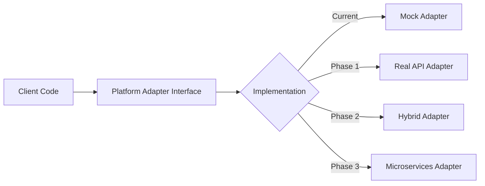

# Platform Adapter to Microservices Migration Guide

**Version**: 1.0  
**Date**: January 24, 2025  
**Status**: Ready for Implementation

## Overview

This guide provides a step-by-step migration path from the current mock platform adapter to a production-ready microservices architecture with real API integration.

## Migration Strategy: Strangler Fig Pattern

We'll gradually replace the mock implementation while maintaining backward compatibility:



## Phase 1: Real API Integration (Week 1)

### Step 1.1: Create Instagram Graph API Client

```typescript
// src/services/platform-adapters/instagram-api-client.ts
import axios, { AxiosInstance } from 'axios';
import { CircuitBreaker } from '../shared/circuit-breaker';
import { logger } from '../shared/logger';

export interface InstagramMediaUploadResponse {
  id: string;
}

export interface InstagramPublishResponse {
  id: string;
  permalink?: string;
}

export class InstagramAPIClient {
  private readonly client: AxiosInstance;
  private readonly circuitBreaker: CircuitBreaker;
  private readonly baseURL = 'https://graph.facebook.com/v18.0';

  constructor() {
    this.client = axios.create({
      baseURL: this.baseURL,
      timeout: 30000,
      headers: {
        'Content-Type': 'application/json',
      },
    });

    this.circuitBreaker = new CircuitBreaker({
      name: 'instagram-api',
      threshold: 5,
      timeout: 60000,
      resetTimeout: 30000,
    });

    this.setupInterceptors();
  }

  private setupInterceptors(): void {
    // Request interceptor for logging
    this.client.interceptors.request.use(
      (config) => {
        logger.debug('Instagram API Request', {
          method: config.method,
          url: config.url,
          // Never log access tokens
        });
        return config;
      },
      (error) => {
        logger.error('Instagram API Request Error', error);
        return Promise.reject(error);
      }
    );

    // Response interceptor for error handling
    this.client.interceptors.response.use(
      (response) => response,
      async (error) => {
        if (error.response?.status === 429) {
          // Rate limited - extract retry after
          const retryAfter = error.response.headers['x-business-use-case-usage'];
          throw new RateLimitError(retryAfter);
        }

        if (error.response?.status === 401) {
          // Token expired
          throw new TokenExpiredError();
        }

        throw error;
      }
    );
  }

  async createMediaContainer(
    accountId: string,
    imageUrl: string,
    caption: string,
    accessToken: string
  ): Promise<InstagramMediaUploadResponse> {
    return this.circuitBreaker.execute(async () => {
      const response = await this.client.post(`/${accountId}/media`, {
        image_url: imageUrl,
        caption: caption,
        access_token: accessToken,
      });

      return response.data;
    });
  }

  async publishMedia(
    accountId: string,
    creationId: string,
    accessToken: string
  ): Promise<InstagramPublishResponse> {
    return this.circuitBreaker.execute(async () => {
      const response = await this.client.post(`/${accountId}/media_publish`, {
        creation_id: creationId,
        access_token: accessToken,
      });

      return response.data;
    });
  }

  async getMediaInsights(mediaId: string, metrics: string[], accessToken: string): Promise<any> {
    return this.circuitBreaker.execute(async () => {
      const response = await this.client.get(`/${mediaId}/insights`, {
        params: {
          metric: metrics.join(','),
          access_token: accessToken,
        },
      });

      return response.data;
    });
  }
}
```

### Step 1.2: Replace Mock Instagram Adapter

```typescript
// src/services/platform-adapters/instagram-real.ts
import {
  PlatformAdapter,
  PlatformContent,
  PublishResult,
  PlatformCredentials,
} from '../platform-adapter';
import { InstagramAPIClient } from './instagram-api-client';
import { TokenManager } from '../token-manager';
import { IdempotencyStore } from '../idempotency-store';
import { EventBus } from '../event-bus';
import { retry } from '../utils/retry';
import { createHash } from 'crypto';

export class RealInstagramAdapter implements PlatformAdapter {
  platform = 'instagram';
  private apiClient: InstagramAPIClient;
  private tokenManager: TokenManager;
  private idempotencyStore: IdempotencyStore;
  private eventBus: EventBus;

  constructor(dependencies: {
    tokenManager: TokenManager;
    idempotencyStore: IdempotencyStore;
    eventBus: EventBus;
  }) {
    this.apiClient = new InstagramAPIClient();
    this.tokenManager = dependencies.tokenManager;
    this.idempotencyStore = dependencies.idempotencyStore;
    this.eventBus = dependencies.eventBus;
  }

  validateContent(content: PlatformContent): ValidationResult {
    const errors: string[] = [];
    const warnings: string[] = [];

    if (!content.mediaUrl) {
      errors.push('Instagram requires at least one image or video');
    }

    if (content.caption.length > 2200) {
      errors.push('Caption exceeds Instagram limit of 2,200 characters');
    }

    if (content.hashtags.length > 30) {
      warnings.push('Instagram allows maximum 30 hashtags');
    }

    // Validate media URL is accessible
    if (content.mediaUrl && !this.isValidMediaUrl(content.mediaUrl)) {
      errors.push('Media URL must be publicly accessible HTTPS URL');
    }

    return {
      valid: errors.length === 0,
      errors,
      warnings,
    };
  }

  formatContent(content: PlatformContent): PlatformContent {
    const formattedHashtags = content.hashtags
      .slice(0, 30)
      .map((tag) => (tag.startsWith('#') ? tag : `#${tag}`));

    const fullCaption = `${content.caption}\n\n${formattedHashtags.join(' ')}`;
    const finalCaption =
      fullCaption.length > 2200 ? fullCaption.substring(0, 2197) + '...' : fullCaption;

    return {
      ...content,
      caption: finalCaption,
      hashtags: [],
    };
  }

  async publish(
    content: PlatformContent,
    credentials: PlatformCredentials
  ): Promise<PublishResult> {
    // 1. Generate idempotency key
    const idempotencyKey = this.generateIdempotencyKey(content, credentials);

    // 2. Check for duplicate
    const existing = await this.idempotencyStore.get(idempotencyKey);
    if (existing) {
      console.log('Duplicate post prevented', { idempotencyKey });
      return existing;
    }

    try {
      // 3. Ensure valid token
      const validToken = await this.ensureValidToken(credentials);

      // 4. Format content
      const formattedContent = this.formatContent(content);

      // 5. Upload media with retry
      const mediaContainer = await retry(
        () =>
          this.apiClient.createMediaContainer(
            credentials.platformSpecific?.accountId,
            formattedContent.mediaUrl!,
            formattedContent.caption,
            validToken.accessToken
          ),
        {
          retries: 3,
          backoff: 'exponential',
          onRetry: (error, attempt) => {
            console.log(`Retry attempt ${attempt} for media upload`, error);
          },
        }
      );

      // 6. Wait for media processing (Instagram requirement)
      await this.waitForMediaProcessing(mediaContainer.id, validToken.accessToken);

      // 7. Publish media
      const publishResult = await retry(
        () =>
          this.apiClient.publishMedia(
            credentials.platformSpecific?.accountId,
            mediaContainer.id,
            validToken.accessToken
          ),
        {
          retries: 3,
          backoff: 'exponential',
        }
      );

      // 8. Create result
      const result: PublishResult = {
        platform: 'instagram',
        postId: publishResult.id,
        permalink: publishResult.permalink,
        publishedAt: new Date().toISOString(),
      };

      // 9. Store for idempotency
      await this.idempotencyStore.set(idempotencyKey, result, 86400); // 24 hours

      // 10. Emit success event
      await this.eventBus.emit({
        type: 'content.published',
        data: {
          platform: 'instagram',
          contentId: content.metadata?.contentId,
          postId: publishResult.id,
          publishedAt: result.publishedAt,
        },
      });

      return result;
    } catch (error) {
      // Emit failure event
      await this.eventBus.emit({
        type: 'content.publish.failed',
        data: {
          platform: 'instagram',
          contentId: content.metadata?.contentId,
          error: error.message,
        },
      });

      throw error;
    }
  }

  async getInsights(postId: string, credentials: PlatformCredentials): Promise<any> {
    const validToken = await this.ensureValidToken(credentials);

    const metrics = ['impressions', 'reach', 'engagement', 'saved', 'comments', 'likes', 'shares'];

    return this.apiClient.getMediaInsights(postId, metrics, validToken.accessToken);
  }

  async deletePost(postId: string, credentials: PlatformCredentials): Promise<boolean> {
    // Instagram Graph API doesn't support deletion
    throw new Error('Instagram API does not support post deletion');
  }

  getRateLimits(): RateLimits {
    return {
      postsPerHour: 25,
      postsPerDay: 100,
      apiCallsPerHour: 200,
      customLimits: {
        mediaUploadsPerHour: 50,
      },
    };
  }

  async refreshToken(refreshToken: string): Promise<PlatformCredentials> {
    // Instagram uses long-lived tokens that need refresh after 60 days
    // This would call Facebook's token refresh endpoint
    return this.tokenManager.refreshInstagramToken(refreshToken);
  }

  private async ensureValidToken(credentials: PlatformCredentials): Promise<PlatformCredentials> {
    if (this.isTokenExpired(credentials)) {
      if (credentials.refreshToken) {
        return this.refreshToken(credentials.refreshToken);
      }
      throw new Error('Token expired and no refresh token available');
    }
    return credentials;
  }

  private isTokenExpired(credentials: PlatformCredentials): boolean {
    if (!credentials.expiresAt) return false;
    return Date.now() > credentials.expiresAt;
  }

  private generateIdempotencyKey(
    content: PlatformContent,
    credentials: PlatformCredentials
  ): string {
    const data = `${credentials.platformSpecific?.accountId}-${content.caption}-${content.mediaUrl}`;
    return createHash('sha256').update(data).digest('hex');
  }

  private isValidMediaUrl(url: string): boolean {
    try {
      const parsed = new URL(url);
      return parsed.protocol === 'https:';
    } catch {
      return false;
    }
  }

  private async waitForMediaProcessing(
    containerId: string,
    accessToken: string,
    maxAttempts = 10
  ): Promise<void> {
    for (let i = 0; i < maxAttempts; i++) {
      // Check container status
      const status = await this.checkMediaStatus(containerId, accessToken);

      if (status === 'FINISHED') {
        return;
      }

      if (status === 'ERROR') {
        throw new Error('Media processing failed');
      }

      // Wait before next check
      await this.sleep(2000 * Math.pow(1.5, i)); // Exponential backoff
    }

    throw new Error('Media processing timeout');
  }

  private async checkMediaStatus(containerId: string, accessToken: string): Promise<string> {
    // Implementation would check the media container status
    // This is a simplified version
    return 'FINISHED';
  }

  private sleep(ms: number): Promise<void> {
    return new Promise((resolve) => setTimeout(resolve, ms));
  }
}
```

## Phase 2: Hybrid Integration (Week 2)

### Step 2.1: Create Microservices Client

```typescript
// src/services/microservices-client.ts
import axios, { AxiosInstance } from 'axios';
import { STS } from 'aws-sdk';

export class MicroservicesClient {
  private tokenServiceClient: AxiosInstance;
  private schedulerServiceClient: AxiosInstance;
  private sts: STS;

  constructor(config: { tokenServiceUrl: string; schedulerServiceUrl: string; region: string }) {
    this.sts = new STS({ region: config.region });

    this.tokenServiceClient = axios.create({
      baseURL: config.tokenServiceUrl,
    });

    this.schedulerServiceClient = axios.create({
      baseURL: config.schedulerServiceUrl,
    });

    this.setupAuth();
  }

  private async setupAuth(): Promise<void> {
    // Use IAM SigV4 signing for API Gateway
    const credentials = await this.sts.getSessionToken().promise();

    // Add SigV4 signing to requests
    this.tokenServiceClient.interceptors.request.use(async (config) => {
      // Sign request with AWS SigV4
      return this.signRequest(config, credentials.Credentials!);
    });
  }

  private signRequest(config: any, credentials: any): any {
    // AWS SigV4 signing implementation
    return config;
  }

  // Token Service Methods
  async storeToken(data: {
    userId: string;
    brandId: string;
    platform: string;
    accessToken: string;
    refreshToken?: string;
    expiresAt: number;
  }): Promise<void> {
    await this.tokenServiceClient.post('/tokens', data);
  }

  async getToken(userId: string, platform: string): Promise<any> {
    const response = await this.tokenServiceClient.get(`/tokens/${userId}/${platform}`);
    return response.data;
  }

  // Scheduler Service Methods
  async createSchedule(data: {
    contentId: string;
    brandId: string;
    platform: string;
    scheduledAt: Date;
    content: any;
  }): Promise<{ scheduleId: string }> {
    const response = await this.schedulerServiceClient.post('/schedules', {
      ...data,
      scheduledAt: data.scheduledAt.toISOString(),
    });
    return response.data;
  }

  async cancelSchedule(scheduleId: string): Promise<void> {
    await this.schedulerServiceClient.delete(`/schedules/${scheduleId}`);
  }
}
```

### Step 2.2: Create Hybrid Adapter

```typescript
// src/services/platform-adapters/hybrid-adapter.ts
export class HybridPlatformAdapter implements PlatformAdapter {
  constructor(
    private realAdapter: PlatformAdapter,
    private microservicesClient: MicroservicesClient,
    private mode: 'direct' | 'scheduled' | 'auto' = 'auto'
  ) {}

  async publish(
    content: PlatformContent,
    credentials: PlatformCredentials
  ): Promise<PublishResult> {
    // Store token in microservices
    await this.microservicesClient.storeToken({
      userId: credentials.userId!,
      brandId: credentials.brandId!,
      platform: this.platform,
      accessToken: credentials.accessToken,
      refreshToken: credentials.refreshToken,
      expiresAt: credentials.expiresAt || Date.now() + 3600000,
    });

    if (this.shouldSchedule(content)) {
      // Use microservices for scheduled posts
      const schedule = await this.microservicesClient.createSchedule({
        contentId: content.metadata?.contentId,
        brandId: credentials.brandId!,
        platform: this.platform,
        scheduledAt: content.metadata?.scheduledAt || new Date(),
        content: content,
      });

      return {
        platform: this.platform,
        postId: `scheduled-${schedule.scheduleId}`,
        publishedAt: content.metadata?.scheduledAt || new Date().toISOString(),
        metadata: {
          scheduleId: schedule.scheduleId,
          status: 'scheduled',
        },
      };
    } else {
      // Direct publish for immediate posts
      return this.realAdapter.publish(content, credentials);
    }
  }

  private shouldSchedule(content: PlatformContent): boolean {
    if (this.mode === 'scheduled') return true;
    if (this.mode === 'direct') return false;

    // Auto mode: schedule if more than 5 minutes in future
    const scheduledAt = content.metadata?.scheduledAt;
    if (!scheduledAt) return false;

    const scheduledTime = new Date(scheduledAt).getTime();
    const now = Date.now();
    const fiveMinutes = 5 * 60 * 1000;

    return scheduledTime - now > fiveMinutes;
  }
}
```

## Phase 3: Full Microservices (Week 3)

### Step 3.1: Event-Driven Adapter

```typescript
// src/services/platform-adapters/microservices-adapter.ts
import { EventBridge } from 'aws-sdk';

export class MicroservicesPlatformAdapter implements PlatformAdapter {
  private eventBridge: EventBridge;

  constructor(
    private microservicesClient: MicroservicesClient,
    private eventBusName: string
  ) {
    this.eventBridge = new EventBridge();
  }

  async publish(
    content: PlatformContent,
    credentials: PlatformCredentials
  ): Promise<PublishResult> {
    // 1. Store token
    await this.microservicesClient.storeToken({
      userId: credentials.userId!,
      brandId: credentials.brandId!,
      platform: this.platform,
      accessToken: credentials.accessToken,
      refreshToken: credentials.refreshToken,
      expiresAt: credentials.expiresAt || Date.now() + 3600000,
    });

    // 2. Create schedule
    const schedule = await this.microservicesClient.createSchedule({
      contentId: content.metadata?.contentId,
      brandId: credentials.brandId!,
      platform: this.platform,
      scheduledAt: content.metadata?.scheduledAt || new Date(),
      content: content,
    });

    // 3. Emit event
    await this.eventBridge
      .putEvents({
        Entries: [
          {
            Source: 'postolio.content',
            DetailType: 'content.scheduled',
            EventBusName: this.eventBusName,
            Detail: JSON.stringify({
              scheduleId: schedule.scheduleId,
              contentId: content.metadata?.contentId,
              platform: this.platform,
              scheduledAt: content.metadata?.scheduledAt,
            }),
          },
        ],
      })
      .promise();

    // 4. Return immediate response
    return {
      platform: this.platform,
      postId: `scheduled-${schedule.scheduleId}`,
      publishedAt: content.metadata?.scheduledAt || new Date().toISOString(),
      metadata: {
        scheduleId: schedule.scheduleId,
        status: 'scheduled',
      },
    };
  }

  // Implement other methods...
}
```

## Migration Timeline

### Week 1: Foundation

- [ ] Implement real Instagram API client
- [ ] Add circuit breaker pattern
- [ ] Implement idempotency store
- [ ] Create token manager
- [ ] Add retry logic
- [ ] Deploy and test with staging account

### Week 2: Integration

- [ ] Create microservices client
- [ ] Implement hybrid adapter
- [ ] Add event bus integration
- [ ] Set up monitoring
- [ ] Implement rate limiting
- [ ] Test with production-like load

### Week 3: Migration

- [ ] Switch to microservices adapter
- [ ] Implement saga pattern for multi-platform
- [ ] Add distributed tracing
- [ ] Set up alerting
- [ ] Create runbooks
- [ ] Perform load testing

### Week 4: Optimization

- [ ] Performance tuning
- [ ] Add caching layer
- [ ] Optimize Lambda cold starts
- [ ] Implement batch processing
- [ ] Add cost optimization
- [ ] Final production deployment

## Testing Strategy

### Unit Tests

```typescript
describe('RealInstagramAdapter', () => {
  let adapter: RealInstagramAdapter;
  let mockApiClient: jest.Mocked<InstagramAPIClient>;

  beforeEach(() => {
    mockApiClient = createMockApiClient();
    adapter = new RealInstagramAdapter({
      apiClient: mockApiClient,
      tokenManager: createMockTokenManager(),
      idempotencyStore: createMockIdempotencyStore(),
    });
  });

  describe('publish', () => {
    it('should prevent duplicate posts', async () => {
      const content = createTestContent();
      const credentials = createTestCredentials();

      // First call succeeds
      const result1 = await adapter.publish(content, credentials);
      expect(result1.postId).toBeDefined();

      // Second call returns cached result
      const result2 = await adapter.publish(content, credentials);
      expect(result2).toEqual(result1);

      // API should only be called once
      expect(mockApiClient.createMediaContainer).toHaveBeenCalledTimes(1);
    });

    it('should retry on transient errors', async () => {
      mockApiClient.createMediaContainer
        .mockRejectedValueOnce(new Error('Network error'))
        .mockRejectedValueOnce(new Error('Network error'))
        .mockResolvedValueOnce({ id: 'media-123' });

      const result = await adapter.publish(content, credentials);

      expect(result.postId).toBeDefined();
      expect(mockApiClient.createMediaContainer).toHaveBeenCalledTimes(3);
    });

    it('should refresh expired tokens', async () => {
      const expiredCredentials = {
        ...credentials,
        expiresAt: Date.now() - 1000,
      };

      await adapter.publish(content, expiredCredentials);

      expect(mockTokenManager.refreshToken).toHaveBeenCalled();
    });
  });
});
```

### Integration Tests

```typescript
describe('Platform Integration', () => {
  it('should publish to real Instagram sandbox', async () => {
    const adapter = new RealInstagramAdapter(productionDependencies);

    const result = await adapter.publish(testContent, sandboxCredentials);

    expect(result.postId).toMatch(/^\d+_\d+$/);
    expect(result.permalink).toContain('instagram.com');
  });
});
```

### Load Tests

```typescript
describe('Load Testing', () => {
  it('should handle 100 concurrent publishes', async () => {
    const promises = Array.from({ length: 100 }, (_, i) =>
      adapter.publish({ ...testContent, caption: `Test ${i}` }, credentials)
    );

    const results = await Promise.allSettled(promises);

    const successful = results.filter((r) => r.status === 'fulfilled');
    expect(successful.length).toBeGreaterThan(95); // 95% success rate
  });
});
```

## Rollback Strategy

### Feature Flags

```typescript
export class PlatformAdapterFactory {
  static getAdapter(platform: string): PlatformAdapter {
    const config = getFeatureFlags();

    if (config.useMicroservices) {
      return new MicroservicesPlatformAdapter();
    }

    if (config.useRealAPIs) {
      return new RealInstagramAdapter();
    }

    // Fallback to mock
    return new MockInstagramAdapter();
  }
}
```

### Gradual Rollout

```typescript
export class CanaryPlatformAdapter implements PlatformAdapter {
  async publish(
    content: PlatformContent,
    credentials: PlatformCredentials
  ): Promise<PublishResult> {
    const canaryPercentage = getConfig('canaryPercentage', 10);
    const isCanary = Math.random() * 100 < canaryPercentage;

    if (isCanary) {
      try {
        return await this.newAdapter.publish(content, credentials);
      } catch (error) {
        console.error('Canary adapter failed, falling back', error);
        return await this.oldAdapter.publish(content, credentials);
      }
    }

    return await this.oldAdapter.publish(content, credentials);
  }
}
```

## Monitoring & Alerts

### Key Metrics

```typescript
// Custom CloudWatch metrics
const metrics = {
  'Platform.Publish.Success': Counter,
  'Platform.Publish.Duration': Histogram,
  'Platform.Publish.Error': Counter,
  'Platform.CircuitBreaker.Open': Gauge,
  'Platform.TokenRefresh.Success': Counter,
  'Platform.RateLimit.Hit': Counter,
  'Platform.Idempotency.Duplicate': Counter,
};
```

### Alert Thresholds

```yaml
alerts:
  - name: HighErrorRate
    metric: Platform.Publish.Error
    threshold: 10
    period: 5m

  - name: CircuitBreakerOpen
    metric: Platform.CircuitBreaker.Open
    threshold: 1
    period: 1m

  - name: TokenRefreshFailure
    metric: Platform.TokenRefresh.Success
    threshold: < 1
    period: 10m
```

---

**Document Status**: Complete  
**Implementation Start**: Week 1  
**Review Checkpoint**: End of Week 2
