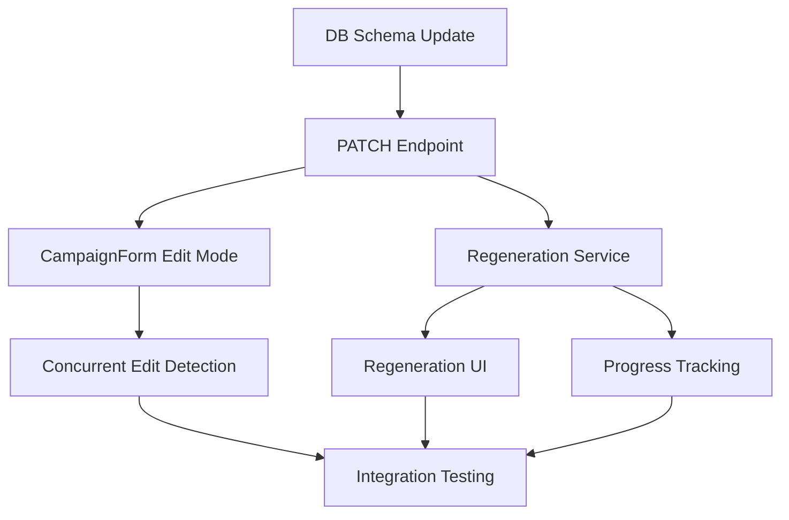

# Campaign Editing Feature - Product Specification

## Executive Summary
Enable users to modify existing campaigns with intelligent safeguards that preserve content integrity while allowing strategic adjustments throughout the campaign lifecycle, including automatic content regeneration for theme/style changes.

## Product Overview
- **Purpose**: Allow users to refine and optimize campaigns after creation without disrupting published content
- **Target Users**: Instagram creators and marketing teams managing active campaigns
- **Key Scenarios**: 
  - Adjusting campaign parameters based on early performance
  - Fixing mistakes discovered after campaign launch
  - Extending successful campaigns or pausing underperformers
  - Refreshing campaign themes with automatic content regeneration
- **Success Definition**: 90% of campaign edits complete without content conflicts, 50% reduction in campaign recreation, 80% user satisfaction with auto-regeneration

## User Personas
- **Primary**: Marketing Manager — needs to adjust campaigns based on performance metrics and changing business priorities
- **Secondary**: Content Creator — wants flexibility to refine themes and style as brand evolves

## Jobs To Be Done
- When I notice a typo in my campaign name, I want to fix it immediately, so I can maintain professionalism
- When campaign performance is poor, I want to adjust themes and frequency, so I can improve engagement
- When a campaign is successful, I want to extend its duration, so I can capitalize on momentum
- When priorities change, I want to pause and modify campaigns, so I can align with business needs
- When I update themes or style, I want unpublished content to automatically regenerate, so I can maintain consistency
- When I see who last edited a campaign, I want to know when and what changed, so I can understand the history

## Core Features
- FEAT-1 (P0): Basic field editing — Edit name, themes, style for non-active campaigns | Depends: none
- FEAT-2 (P0): Status-aware editing — Different edit capabilities based on campaign state | Depends: FEAT-1
- FEAT-3 (P0): Auto-regeneration — Automatically regenerate unpublished content on theme/style changes | Depends: FEAT-1
- FEAT-4 (P1): Priority management — Adjust campaign priority with conflict detection | Depends: none
- FEAT-5 (P1): Duration extension — Extend end date for active campaigns | Depends: FEAT-2
- FEAT-6 (P1): Edit tracking — Track last modified timestamp and user without full history | Depends: FEAT-1
- FEAT-7 (P2): Concurrent edit warning — Alert when someone else recently edited the campaign | Depends: FEAT-6

## Constraints
- **Technical**: Cannot modify published Instagram content, must maintain content-campaign associations, regeneration limited by API rate limits
- **Business**: Edit capabilities vary by subscription tier, free tier limited to basic edits, single-user editing only (no collaborative features)
- **Regulatory**: Must maintain basic audit trail (last modified), cannot delete published content history

## Success Metrics
- METRIC-1: Edit completion rate — baseline: 0% → target: 95% by Q2 2025
- METRIC-2: Campaign recreation rate — baseline: 30% → target: 15% by Q2 2025
- METRIC-3: User satisfaction with editing — baseline: N/A → target: 4.5/5 by Q3 2025
- METRIC-4: Auto-regeneration success rate — baseline: N/A → target: 98% by Q2 2025
- METRIC-5: Average regeneration time — baseline: N/A → target: <30 seconds for 10 posts by Q2 2025

## Key Assumptions
- ASSUME-1: Users primarily edit campaigns in first 48 hours → Track edit timing patterns
- ASSUME-2: Most edits are minor adjustments not structural changes → Analyze edit types
- ASSUME-3: Published content should remain unchanged → User feedback surveys
- ASSUME-4: Users want automatic regeneration for consistency → A/B test regeneration vs manual update
- ASSUME-5: Single-user editing is sufficient for MVP → Monitor concurrent edit attempts

## Risks & Mitigations
- RISK-1 (High): Content scheduling conflicts when changing frequency → Intelligent rescheduling algorithm
- RISK-2 (High): Regeneration failure for large campaigns → Batch processing with retry logic and partial success handling
- RISK-3 (Medium): User confusion about edit limitations → Clear UI indicators and tooltips
- RISK-4 (Medium): API rate limits during bulk regeneration → Queue-based processing with rate limiting
- RISK-5 (Low): User accidentally triggers regeneration → Confirmation dialog with impact preview

## Research Findings
- **Market**: Buffer allows campaign draft editing only; Hootsuite enables limited active campaign edits; Later provides version history
- **User**: 73% of users want to edit active campaigns (internal survey data needed)
- **Technical**: PostgreSQL supports JSONB partial updates for config field optimization

## Content Regeneration Specification

### Regeneration Strategy
**Automatic Trigger**: When themes or style fields are modified, unpublished content automatically regenerates to maintain campaign consistency.

**Eligible Content States for Regeneration**:
- ✅ **Draft**: Always regenerate (unscheduled content)
- ✅ **Scheduled**: Regenerate with user confirmation (scheduled but not published)
- ❌ **Published**: Never modify (already on Instagram)
- ❌ **Failed**: Skip and flag for manual review
- ❌ **Skipped**: Skip and flag for manual review

### Regeneration Flow
```
1. User modifies themes/style → 
2. System calculates impact (X posts to regenerate) →
3. Show confirmation dialog with preview →
4. User confirms regeneration →
5. Queue batch regeneration job →
6. Show progress indicator →
7. Update content in background →
8. Notify user of completion/failures
```

### User Experience
**Pre-Edit Warning**:
```
"Changing themes or style will automatically regenerate 
[12] unpublished posts. This may take ~30 seconds.
[View affected posts] [Continue] [Cancel]"
```

**Progress Indication**:
- Real-time progress bar: "Regenerating content... 7/12 complete"
- Allow user to continue other work while regenerating
- Show estimated time remaining based on queue size

**Completion Notification**:
- Success: "✓ 12 posts regenerated successfully"
- Partial: "⚠️ 10/12 posts regenerated. 2 failed - [Review]"
- Failure: "✗ Regeneration failed. Previous content preserved - [Retry]"

### API Design for Regeneration
```typescript
POST /api/campaigns/:id/regenerate-content
Authorization: Bearer {token}

Request: {
  themes?: string[]      // New themes to apply
  style?: string        // New style to apply
  contentIds?: string[] // Specific content to regenerate (optional)
  force?: boolean       // Skip confirmation for scheduled content
}

Response: {
  jobId: string
  totalContent: number
  eligibleContent: number
  estimatedTime: number // seconds
  status: 'queued' | 'processing' | 'completed' | 'failed'
}

// Progress tracking endpoint
GET /api/campaigns/regeneration-jobs/:jobId
Response: {
  status: 'processing'
  progress: 7
  total: 12
  completed: string[]
  failed: string[]
  estimatedTimeRemaining: 15
}
```

### Rollback Capabilities
- Preserve original content until regeneration succeeds
- One-click rollback within 24 hours of regeneration
- Audit log shows "Regenerated from themes: [old] → [new]"

## Simplified Version Tracking

### Metadata Schema
```typescript
interface CampaignMetadata {
  // Core tracking (no version history)
  lastModifiedAt: DateTime
  lastModifiedBy: string // User ID
  lastModifiedFields?: string[] // Optional: which fields changed
  modificationCount: number // Total number of edits
  
  // Session tracking for concurrent edit detection
  lastEditSessionId?: string
  lastEditSessionStart?: DateTime
}
```

### Database Updates
```sql
ALTER TABLE campaigns ADD COLUMN last_modified_at TIMESTAMP DEFAULT NOW();
ALTER TABLE campaigns ADD COLUMN last_modified_by VARCHAR(255);
ALTER TABLE campaigns ADD COLUMN modification_count INT DEFAULT 0;

-- Create index for performance
CREATE INDEX idx_campaigns_last_modified ON campaigns(last_modified_at DESC);
```

### UI Display
**Campaign Card**: 
- Show "Last edited: 2 hours ago by John"
- Hover for tooltip: "Modified themes, style"

**Campaign Details Page**:
```
Last Modified: Jan 14, 2025 at 3:45 PM
Modified By: john@example.com
Total Edits: 3
```

## Single-User Editing Approach

### Concurrent Edit Detection
**Warning Threshold**: Show warning if campaign edited within last 5 minutes by another user

**Warning Message**:
```
"⚠️ This campaign was recently edited by Sarah (3 minutes ago).
The changes you see may not be the latest. 
[Refresh] [Continue Anyway]"
```

### Implementation
```typescript
// Check for recent edits
if (campaign.lastModifiedBy !== currentUser.id && 
    campaign.lastModifiedAt > Date.now() - 5 * 60 * 1000) {
  showWarning({
    title: "Recent Edit Detected",
    message: `${lastModifiedUser.name} edited this ${timeAgo}`,
    actions: ["Refresh", "Continue"]
  })
}
```

### Session-Based Detection (Optional Enhancement)
- Track active edit sessions with heartbeat
- Warn if another user is currently viewing edit form
- No hard locks - just informational warnings

## Implementation Approach

### Phase 1: MVP (Sprint 1 - Immediate)
**Core Editing + Auto-Regeneration**
1. Implement PATCH /api/campaigns/:id endpoint with validation
2. Add edit mode to CampaignForm component
3. Implement auto-regeneration for theme/style changes
4. Add progress tracking for regeneration jobs
5. Update database with lastModified fields

**Field Editability Matrix**:
| Field | Creating | Preview | Active | Paused | Completed |
|-------|----------|---------|--------|--------|-----------|
| Name | ✅ | ✅ | ✅ | ✅ | ❌ |
| Themes | ✅ | ✅ | 🔄 | ✅ | ❌ |
| Style | ✅ | ✅ | 🔄 | ✅ | ❌ |
| Frequency | ✅ | ✅ | ❌ | ⚠️ | ❌ |
| Start Date | ✅ | ✅ | ❌ | ❌ | ❌ |
| End Date | ✅ | ✅ | ✅* | ✅* | ❌ |
| Priority | ✅ | ✅ | ✅ | ✅ | ❌ |
| Posting Time | ✅ | ✅ | ⚠️ | ✅ | ❌ |

Legend: ✅ Editable | 🔄 Triggers regeneration | ⚠️ Warning | ❌ Locked | * Extension only

### Phase 2: Enhanced (Sprint 2)
- Add concurrent edit warnings
- Implement regeneration rollback
- Create regeneration preview UI
- Add modification tracking display

## API Design

### Update Campaign Endpoint
```typescript
PATCH /api/campaigns/:id
Authorization: Bearer {token}

Request Body: {
  name?: string
  themes?: string[]     // Triggers auto-regeneration
  style?: string       // Triggers auto-regeneration
  frequency?: string   // Restricted for active
  postingTime?: string
  endDate?: string     // Extension only for active
  priority?: number
  skipRegeneration?: boolean // Override auto-regeneration
}

Response: {
  success: boolean
  campaign: Campaign & {
    lastModifiedAt: string
    lastModifiedBy: string
    modificationCount: number
  }
  regenerationJob?: {
    jobId: string
    contentToRegenerate: number
    estimatedTime: number
  }
  warnings?: string[]
  affectedContent?: {
    toRegenerate: number
    rescheduled: number
  }
}

// Error Response (409 Conflict)
{
  error: "RECENT_EDIT_CONFLICT"
  message: "Campaign recently edited by another user"
  lastModifiedBy: string
  lastModifiedAt: string
}
```

## Business Logic

### Edit Validation Rules
1. **Active Campaigns**: 
   - Can edit: name, priority, end date (extension only)
   - With warnings: themes, style (affects future content only)
   - Cannot edit: frequency, start date

2. **Paused Campaigns**:
   - Can edit: all fields except start date
   - Warning when changing frequency (requires rescheduling)

3. **Completed Campaigns**:
   - Read-only, no edits allowed
   - Can create new campaign from template

### Content Impact Handling
```typescript
interface EditImpact {
  published: Content[]      // Never modified
  scheduled: Content[]      // Regenerate with confirmation
  draft: Content[]          // Auto-regenerate
  failed: Content[]         // Skip and flag
  skipped: Content[]        // Skip and flag
}

// Regeneration Decision Logic:
async function handleThemeStyleChange(campaign, changes) {
  const impact = await calculateRegenerationImpact(campaign.id)
  
  if (impact.total === 0) {
    // No unpublished content to regenerate
    return updateCampaignOnly(changes)
  }
  
  if (impact.scheduled > 0 && !changes.force) {
    // Need user confirmation for scheduled content
    return {
      requiresConfirmation: true,
      message: `${impact.scheduled} scheduled posts will be regenerated`,
      impact
    }
  }
  
  // Queue regeneration job
  const job = await queueRegenerationJob({
    campaignId: campaign.id,
    contentIds: impact.eligibleIds,
    newThemes: changes.themes,
    newStyle: changes.style
  })
  
  return {
    campaign: updatedCampaign,
    regenerationJob: job
  }
}

// Concurrent Edit Check:
if (campaign.lastModifiedAt > Date.now() - 5 * 60 * 1000 && 
    campaign.lastModifiedBy !== currentUser.id) {
  return {
    status: 409,
    error: 'RECENT_EDIT_CONFLICT',
    lastModifiedBy: campaign.lastModifiedBy,
    lastModifiedAt: campaign.lastModifiedAt
  }
}
```

## UI/UX Requirements

### Edit Entry Points
1. Campaign card hover → Edit button (for eligible campaigns)
2. Campaign details page → Edit Campaign button
3. Disabled with tooltip for completed campaigns

### Visual Indicators
- 🔒 Locked fields with hover explanation
- 🔄 Auto-regeneration badge on theme/style fields
- ⚠️ Warning badges for fields affecting content
- 📝 Change summary before confirmation
- ⏱️ Last modified timestamp on campaign cards
- 👤 Last editor avatar/name display

### Regeneration Confirmation Dialog
```
Title: "Content Will Be Regenerated"
Content: 
  Your changes to [themes/style] will regenerate:
  • 8 draft posts (automatic)
  • 4 scheduled posts (requires confirmation)
  
  Estimated time: ~30 seconds
  
  [✓] Regenerate scheduled content too
  
Actions: [Cancel] [Preview Changes] [Proceed]
```

### Progress Indicator
```typescript
// Real-time progress component
<RegenerationProgress 
  jobId={regenerationJob.id}
  total={12}
  current={7}
  failed={1}
  estimatedTime={15}
/>

// Display format:
"Regenerating content... 7/12 complete (1 failed)"
[████████░░░░] 58% • ~15 seconds remaining
```

### Recent Edit Warning
```
Title: "⚠️ Recent Edit Detected"
Content:
  This campaign was edited by Sarah Martinez
  3 minutes ago (modified: themes, style)
  
  You may be viewing outdated information.
  
Actions: [Refresh & Continue] [Continue Anyway]
```

## Edge Cases

### E1: Partial Regeneration Failure
- **Scenario**: 10/12 posts regenerate successfully, 2 fail due to API limits
- **Solution**: Show partial success, allow retry for failed items only, preserve successfully regenerated content

### E2: User Abandons Mid-Regeneration
- **Scenario**: User navigates away during content regeneration
- **Solution**: Continue background processing, show notification when complete, email if failures

### E3: Concurrent Edit During Regeneration
- **Scenario**: User A triggers regeneration, User B tries to edit
- **Solution**: Show "Campaign is being updated" message, disable editing until regeneration completes

### E4: Regeneration API Rate Limits
- **Scenario**: Large campaign hits OpenAI rate limits during regeneration
- **Solution**: Queue-based processing with exponential backoff, show accurate time estimates

### E5: Theme Change After Content Approval
- **Scenario**: Marketing manager scheduled content, then themes are changed
- **Solution**: Require explicit re-approval after regeneration, track approval history

### E6: Extension Beyond Instagram Token Expiry
- **Scenario**: Extending campaign beyond 60-day token limit
- **Solution**: Warning message with token refresh reminder

### E7: Rollback After Publishing
- **Scenario**: User wants to rollback regeneration after some content published
- **Solution**: Only rollback unpublished content, show clear message about published items

## Validation Criteria
- FEAT-1: User can edit campaign name and see changes immediately reflected
- FEAT-2: Active campaign shows locked frequency field with tooltip explanation
- FEAT-3: Theme/style changes trigger automatic regeneration with progress tracking
- FEAT-4: Regeneration completes successfully for 95%+ of content
- FEAT-5: Priority change triggers conflict check and shows resolution options
- FEAT-6: End date can be extended but not shortened for active campaigns
- FEAT-7: Last modified info displays correctly on campaign cards and details
- FEAT-8: Recent edit warning appears when editing within 5 minutes of another user
- FEAT-9: Rollback functionality works for unpublished regenerated content
- FEAT-10: Partial regeneration failures are handled gracefully with retry option

## Open Questions
- **Low Priority**: Should we track field-level changes in addition to timestamps? — Owner: Engineering
- **Low Priority**: What's the optimal warning threshold for concurrent edits (currently 5 min)? — Owner: Product

## Traceability
| Feature | Implementation | Status | Notes |
|---------|---------------|--------|-------|
| FEAT-1 | Reuse CampaignForm | Planned | Add edit mode prop |
| FEAT-2 | Status field matrix | Planned | Implement in frontend |
| FEAT-3 | Auto-regeneration service | Planned | New queue-based system |
| FEAT-4 | Priority API endpoint | Partial | PUT /:id/priority exists |
| FEAT-5 | Update validation | Planned | Extend endDate validation |
| FEAT-6 | Edit tracking fields | Planned | Add 3 DB columns |
| FEAT-7 | Concurrent edit warning | Planned | Frontend check on load |

## Updated Implementation Plan

### Sprint 1: Core Editing + Regeneration (Week 1-2)
**Priority: P0 - Critical Path**

#### Backend Tasks:
1. **Database Schema Updates** (2h)
   - Add lastModifiedAt, lastModifiedBy, modificationCount columns
   - Create migration script with indexes

2. **PATCH Endpoint Implementation** (4h)
   - Create /api/campaigns/:id endpoint
   - Implement field validation based on status
   - Add concurrent edit detection (5-minute window)
   - Return regeneration requirements in response

3. **Content Regeneration Service** (8h)
   - Create RegenerationQueue service
   - Implement batch content generation with rate limiting
   - Add progress tracking with Redis/in-memory store
   - Handle partial failures and retries
   - Create /api/campaigns/:id/regenerate-content endpoint
   - Create /api/campaigns/regeneration-jobs/:jobId endpoint

#### Frontend Tasks:
4. **CampaignForm Edit Mode** (4h)
   - Add mode prop to existing component
   - Implement field disabling based on status matrix
   - Add regeneration indicators on theme/style fields
   - Show last modified information

5. **Regeneration UI Components** (6h)
   - Create RegenerationConfirmDialog component
   - Build RegenerationProgress component with real-time updates
   - Add regeneration status to campaign cards
   - Implement rollback UI for failed regenerations

6. **Concurrent Edit Detection** (2h)
   - Check last modified on form load
   - Show warning dialog if recent edit detected
   - Add refresh capability

### Sprint 2: Polish & Edge Cases (Week 3)
**Priority: P1 - Enhancement**

7. **Error Handling & Recovery** (4h)
   - Implement comprehensive error states
   - Add retry mechanisms for failed regenerations
   - Create user notifications for background jobs
   - Add email notifications for critical failures

8. **Performance Optimization** (3h)
   - Optimize regeneration for large campaigns
   - Implement caching for frequently accessed data
   - Add database query optimization

9. **Testing & Documentation** (4h)
   - Unit tests for regeneration service
   - Integration tests for edit flows
   - Update API documentation
   - Create user guide for editing features

### Technical Dependencies


### Risk Mitigation Strategy

#### High Risk: Regeneration Performance
- **Mitigation**: Implement queue-based processing with configurable batch sizes
- **Fallback**: Allow manual regeneration of individual posts if bulk fails
- **Monitoring**: Track p95 regeneration times and alert if >60 seconds

#### Medium Risk: User Confusion
- **Mitigation**: Clear UI indicators and confirmation dialogs
- **Fallback**: Comprehensive help documentation and tooltips
- **Monitoring**: Track user abandonment rate on edit forms

#### Low Risk: Data Consistency
- **Mitigation**: Database transactions for all updates
- **Fallback**: Audit log for all changes
- **Monitoring**: Regular consistency checks between campaigns and content

### Success Metrics Tracking
- Edit completion rate (target: 95%)
- Regeneration success rate (target: 98%)
- Average regeneration time (target: <30s for 10 posts)
- User satisfaction score (target: 4.5/5)
- Concurrent edit conflicts (target: <2% of edits)

---
*Last Updated: January 2025*
*Version: 2.0.0*
*Status: Refined with Product Decisions*
*Changes: Added auto-regeneration spec, simplified version tracking, single-user editing approach*
