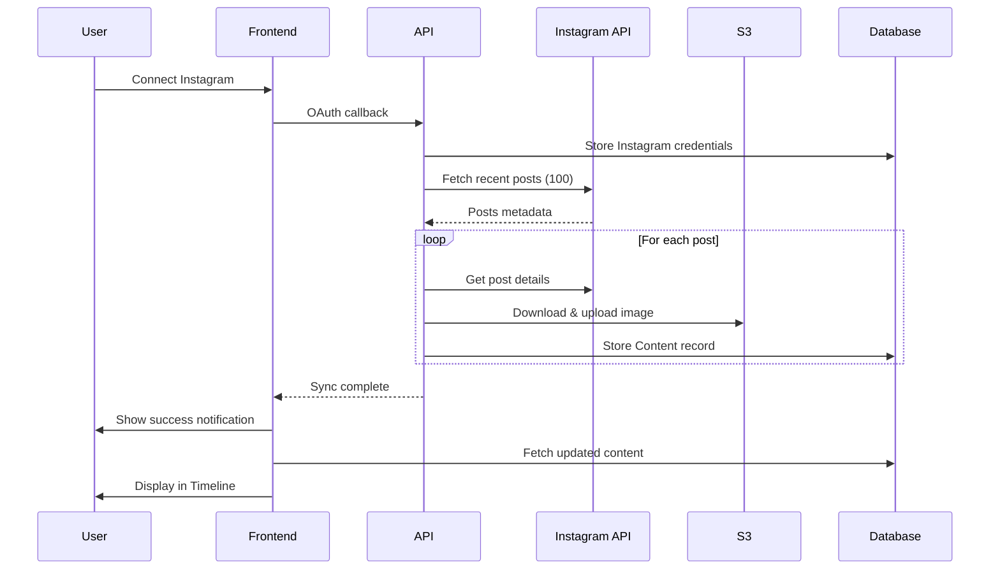

# Product Spec: Instagram Post History Sync

**Feature**: Automatic sync of published Instagram posts
**Status**: Planning
**Created**: 2025-10-08
**Owner**: Engineering Team

---

## 1. Overview

### Problem Statement

When users connect their Instagram account to Postolio, we only track posts published through our application. Users cannot see their existing Instagram posts in our Timeline and Calendar views, creating an incomplete picture of their content strategy.

### Solution

Automatically fetch and sync published Instagram posts when users connect their account, then display them alongside app-generated content in Timeline and Calendar views.

### Success Metrics

- 95% of users successfully sync posts on first Instagram connection
- Average sync time <3 minutes for 100 posts
- 90% image download success rate
- Users can view last 30 days of Instagram history in Postolio

---

## 2. User Stories

### Primary User Story

**As a** content creator
**I want** to see my existing Instagram posts in Postolio's timeline
**So that** I have a complete view of my content calendar in one place

### Additional User Stories

1. **As a** new Postolio user
   **I want** my recent Instagram posts automatically imported
   **So that** I can immediately see my content history without manual work

2. **As a** content manager
   **I want** to manually refresh my Instagram post history
   **So that** I can sync posts I published outside of Postolio

3. **As a** brand manager
   **I want** to see engagement metrics for imported posts
   **So that** I can analyze performance across all my content

---

## 3. Requirements

### Functional Requirements

#### FR-1: Initial Sync on Connection

- **MUST** automatically trigger sync when Instagram account first connected
- **MUST** fetch last 30 days OR 100 posts (whichever is smaller)
- **MUST** run in background without blocking user flow
- **SHOULD** show notification when sync completes

#### FR-2: Post Data Storage

- **MUST** store post metadata (caption, hashtags, timestamp, permalink)
- **MUST** download and store post images to S3
- **MUST** store engagement metrics (likes, comments count)
- **MUST** mark posts as `status='published'`
- **SHOULD** distinguish imported posts from app-generated posts

#### FR-3: Manual Sync

- **MUST** provide manual "Sync Instagram Posts" button in brand settings
- **MUST** show loading state during sync
- **MUST** prevent duplicate syncs within 15 minutes
- **SHOULD** show progress indicator (e.g., "Syncing... 45/100")

#### FR-4: Timeline/Calendar Display

- **MUST** display imported posts in Timeline view
- **MUST** display imported posts in Calendar view
- **MUST** show visual indicator for imported vs created posts
- **SHOULD** allow filtering by post source

#### FR-5: Duplicate Prevention

- **MUST** detect and skip posts already in database
- **MUST** use Instagram post ID as unique identifier
- **MUST** handle re-sync without creating duplicates

### Non-Functional Requirements

#### NFR-1: Performance

- **MUST** complete sync of 100 posts in <3 minutes
- **MUST** not block UI during sync
- **SHOULD** show incremental progress updates

#### NFR-2: Rate Limiting

- **MUST** respect Instagram API rate limit (200 req/hour)
- **MUST** implement cooldown period between syncs (15 min)
- **SHOULD** gracefully handle rate limit exceeded errors

#### NFR-3: Reliability

- **MUST** handle failed image downloads gracefully
- **MUST** continue sync even if individual posts fail
- **MUST** provide detailed error messages for failures
- **SHOULD** retry failed downloads

#### NFR-4: Data Integrity

- **MUST** maintain referential integrity with Brand records
- **MUST** clean up orphaned images if sync fails
- **SHOULD** log all sync operations for debugging

---

## 4. User Experience

### Initial Connection Flow

```
1. User clicks "Connect Instagram" button
   └─> OAuth flow redirects to Instagram

2. User authorizes Postolio
   └─> Redirect back to brand settings

3. Success message shown:
   "✓ Instagram connected! Syncing your recent posts..."

4. Background sync starts (non-blocking)
   └─> User can continue using the app

5. Toast notification after completion:
   "✓ Synced 47 posts from Instagram"

6. Timeline automatically refreshes to show imported posts
```

### Manual Sync Flow

```
1. User navigates to Brand Settings → Instagram section

2. User clicks "Sync Instagram Posts" button

3. Button shows loading state:
   [🔄 Syncing posts... (23/50)]

4. On completion, success message:
   "✓ Synced 23 new posts, skipped 27 existing"

5. Timeline/Calendar automatically refreshes
```

### Error Scenarios

#### Rate Limit Exceeded

```
Alert: ⚠️ Instagram rate limit exceeded
       Please try again in 45 minutes.

[Dismiss]
```

#### Partial Sync Failure

```
Alert: ⚠️ Synced 45/50 posts successfully
       5 posts failed due to image download errors

[View Details] [Retry Failed] [Dismiss]
```

#### No New Posts

```
Toast: ℹ️ No new posts to sync
       All recent posts are already imported.
```

---

## 5. Design Decisions

### 5.1 Sync Strategy

**Decision**: Hybrid time + count-based sync
**Rationale**:

- 30 days matches industry standards (Buffer, Hootsuite)
- 100 posts limit prevents overwhelming large accounts
- Protects against rate limits
- Balances completeness with performance

**Alternatives Considered**:

- Time-only (30 days): Could fetch thousands of posts for active accounts
- Count-only (100 posts): Might miss recent posts for inactive accounts
- Full history sync: Too slow and hits API limits

### 5.2 Image Storage

**Decision**: Download all images to S3
**Rationale**:

- Consistency with app-generated content
- Enables offline/cached viewing
- Instagram URLs expire over time
- Allows image transformations (thumbnails, etc.)

**Alternatives Considered**:

- Link to Instagram URLs: URLs expire, no offline support
- Lazy download: Complex logic, inconsistent UX

### 5.3 When to Sync

**Decision**: Initial sync + manual refresh (MVP)
**Rationale**:

- Covers primary use case (onboarding)
- Simple implementation
- User-controlled (no surprise API usage)

**Future Enhancements**:

- Daily background sync
- Instagram webhook integration
- Smart incremental sync

### 5.4 Video Handling

**Decision**: Skip videos in MVP
**Rationale**:

- Instagram API doesn't provide direct video URLs
- Video storage is expensive
- Most users post primarily images
- Can add in future iteration

---

## 6. Technical Architecture

### High-Level Flow



### Data Flow

1. **Fetch Phase**: Get post metadata from Instagram API
2. **Download Phase**: Download images concurrently (3 at a time)
3. **Store Phase**: Create Content records in database
4. **Display Phase**: Show posts in Timeline/Calendar

### Database Schema (Existing)

```prisma
model Content {
  id                 String        @id @default(cuid())
  brandId            String

  // Post content
  caption            String
  hashtags           String[]

  // Status tracking
  status             ContentStatus  // 'published' for synced posts
  postedAt           DateTime?      // Instagram post timestamp

  // Instagram metadata
  // Removed in v2: instagramPostId / instagramPermalink on Content

  // Image storage
  s3ImageKey         String?        // S3 object key
  imageRegion        String?        // AWS region
  retentionExpiresAt DateTime?      // Retention policy

  // Analytics
  // Removed in v2: analytics JSON on Content; persisted as MetricSample + PublicationMetricsLatest

  // Source tracking
  generationParams   Json?          // {source: 'instagram_import'}

  brand              Brand          @relation(...)
}
```

**Note**: No schema changes required! Existing structure supports all needs.

---

## 7. API Specifications

### 7.1 Sync Instagram Posts

**Endpoint**: `POST /api/instagram/sync-posts/:brandId`

**Request**:

```json
{
  "maxPosts": 100, // Optional, default 100
  "maxDays": 30 // Optional, default 30
}
```

**Response** (Success):

```json
{
  "success": true,
  "results": {
    "synced": 47,
    "skipped": 3,
    "failed": 0,
    "errors": []
  },
  "message": "Synced 47 posts, skipped 3, failed 0"
}
```

**Response** (Rate Limited):

```json
{
  "success": false,
  "error": "Rate limit exceeded",
  "retryAfter": "2025-10-08T15:30:00Z"
}
```

**Response** (In Progress):

```json
{
  "success": false,
  "error": "Sync already in progress",
  "message": "Please wait 15 minutes before syncing again"
}
```

### 7.2 Get Sync Status

**Endpoint**: `GET /api/instagram/sync-status/:brandId`

**Response**:

```json
{
  "lastSyncAt": "2025-10-08T14:30:00Z",
  "isInProgress": false,
  "nextSyncAllowed": "2025-10-08T14:45:00Z",
  "totalPostsSynced": 47,
  "lastSyncResults": {
    "synced": 47,
    "skipped": 3,
    "failed": 0
  }
}
```

---

## 8. Edge Cases & Error Handling

### Edge Case 1: Large Accounts (10,000+ posts)

**Scenario**: User has 10,000+ posts on Instagram
**Handling**:

- Hard limit at 100 posts for initial sync
- Show message: "Synced your 100 most recent posts. Run sync again to fetch older posts."
- Allow manual trigger for incremental sync

### Edge Case 2: No Recent Posts

**Scenario**: User hasn't posted in 60+ days
**Handling**:

- Fetch available posts (even if <100)
- Show message: "Synced all posts from last 30 days (15 posts)"

### Edge Case 3: Image Download Failures

**Scenario**: Instagram CDN is slow/unavailable
**Handling**:

- Store post metadata without image
- Mark in `generationParams`: `imageDownloadFailed: true`
- Allow retry later
- Show partial success: "Synced 50 posts (5 without images)"

### Edge Case 4: Video Posts

**Scenario**: Post is a video, not an image
**Handling**:

- Skip video posts in MVP
- Track count: "Synced 45 posts (5 videos skipped)"
- Future: Store video thumbnail

### Edge Case 5: Carousel Posts

**Scenario**: Post contains multiple images
**Handling**:

- MVP: Fetch first image only
- Store all image URLs in `generationParams`
- Future: Support multiple images per post

### Edge Case 6: Deleted Instagram Posts

**Scenario**: Post exists in database but deleted from Instagram
**Handling**:

- Keep in database (historical record)
- Maybe add `deletedFromInstagram: true` flag in future
- Webhook can notify of deletions

---

## 9. Success Criteria

### Launch Criteria (MVP)

- [ ] Initial sync triggers on Instagram connection
- [ ] Syncs 30 days / 100 posts successfully
- [ ] Downloads images to S3
- [ ] Displays posts in Timeline/Calendar
- [ ] Manual sync button works
- [ ] Prevents duplicate posts
- [ ] Handles rate limits gracefully
- [ ] Shows loading and success states
- [ ] <3 minute sync time for 100 posts
- [ ] 90% image download success rate

### Post-Launch Metrics

- **Adoption**: % of users with Instagram connected who trigger sync
- **Success Rate**: % of syncs that complete without errors
- **Performance**: Average sync time per 100 posts
- **Reliability**: Image download success rate
- **Engagement**: % of users viewing synced posts in Timeline

---

## 10. Out of Scope (Future Iterations)

### Phase 2 Enhancements

- Daily background sync to catch new posts
- Instagram webhook integration for real-time sync
- Video post support (thumbnails + playback)
- Carousel post support (multiple images)
- Historical analytics sync (impressions, reach)
- Selective sync (filter by date range, post type)

### Not Planned

- Sync Instagram Stories (ephemeral, API restrictions)
- Sync Instagram Reels separately (treat as posts)
- Edit imported posts (read-only for data integrity)
- Delete imported posts (keep as historical record)
- Two-way sync (editing in Postolio → update Instagram)

---

## 11. Dependencies

### Internal Dependencies

- Instagram OAuth integration (existing)
- S3 image upload service (existing)
- Token Service for credential management (existing)
- Timeline/Calendar views (existing)

### External Dependencies

- Instagram Graph API v23.0+
- AWS S3 bucket
- Redis for rate limiting and sync state

### API Permissions Required

- `instagram_basic` - Read profile and media
- `pages_read_engagement` - Access page data
- `pages_show_list` - List pages

---

## 12. Testing Strategy

### Manual Testing

- [ ] Connect new Instagram account → verify auto-sync
- [ ] Sync account with 100+ posts → verify limit
- [ ] Sync same account twice → verify no duplicates
- [ ] Check Timeline → verify posts display correctly
- [ ] Check Calendar → verify posts display correctly
- [ ] Test with account with videos → verify graceful handling
- [ ] Disconnect/reconnect → verify data persists

### Automated Testing

- [ ] Unit tests for sync logic
- [ ] Integration tests for API endpoints
- [ ] Mock Instagram API responses
- [ ] Test rate limiting
- [ ] Test duplicate detection
- [ ] Test error handling

---

## 13. Rollout Plan

### Phase 1: Internal Testing (Week 1)

- Deploy to staging environment
- Test with team Instagram accounts
- Validate sync performance
- Fix critical bugs

### Phase 2: Beta Testing (Week 2)

- Enable for 10-20 beta users
- Monitor error rates and performance
- Gather user feedback
- Iterate on UX

### Phase 3: Gradual Rollout (Week 3)

- Enable for 25% of users
- Monitor metrics and errors
- Scale to 50%, then 100%
- Full production release

### Rollback Plan

- Feature flag to disable sync
- Keep existing OAuth flow
- No breaking changes to database
- Can disable without data loss

---

## 14. Open Questions

1. **Q**: Should we sync comments/replies along with posts?
   **A**: Out of scope for MVP. Focus on post content only.

2. **Q**: What happens if user revokes Instagram access mid-sync?
   **A**: Handle OAuth errors gracefully, show error message, keep partial data.

3. **Q**: Should imported posts be editable?
   **A**: No, treat as read-only to maintain data integrity with Instagram.

4. **Q**: How to handle different timezones for post timestamps?
   **A**: Store in UTC, display in user's timezone (existing pattern).

5. **Q**: Should we backfill analytics data over time?
   **A**: Future enhancement. Store current metrics only in MVP.

---

## 15. Appendix

### Research Summary

- **Industry Standards**: Buffer (30d), Hootsuite (28d-12mo), Sprinklr (60d)
- **Instagram Limits**: 10,000 posts max, 100 posts/request, 200 API calls/hour
- **Pagination**: Cursor-based with `after` parameter
- **Image Expiry**: Instagram CDN URLs expire, must download

### Related Documents

- `implementation-plan-instagram-post-sync.md` - Technical implementation
- `OAUTH_ARCHITECTURE_REVIEW.md` - Instagram OAuth setup
- `product-spec-token-service.md` - Token management

---

**Document Version**: 1.0
**Last Updated**: 2025-10-08
**Status**: Ready for Implementation
